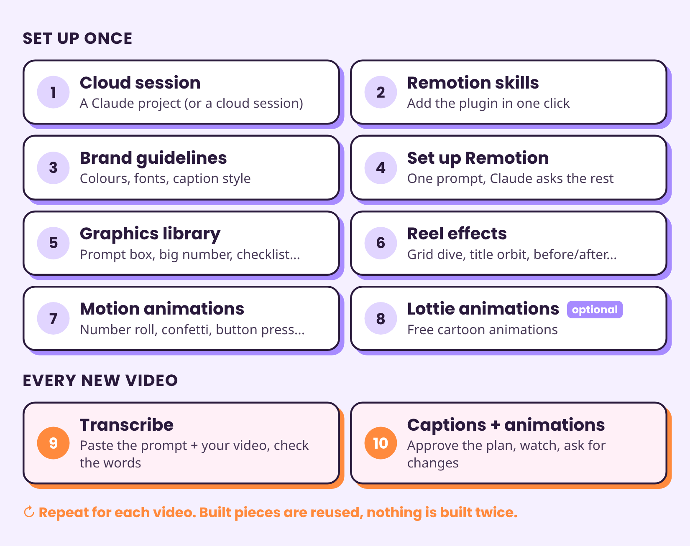
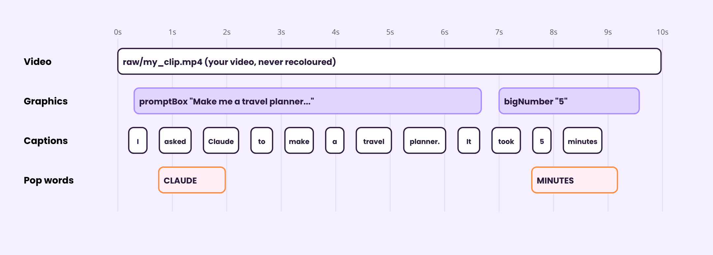
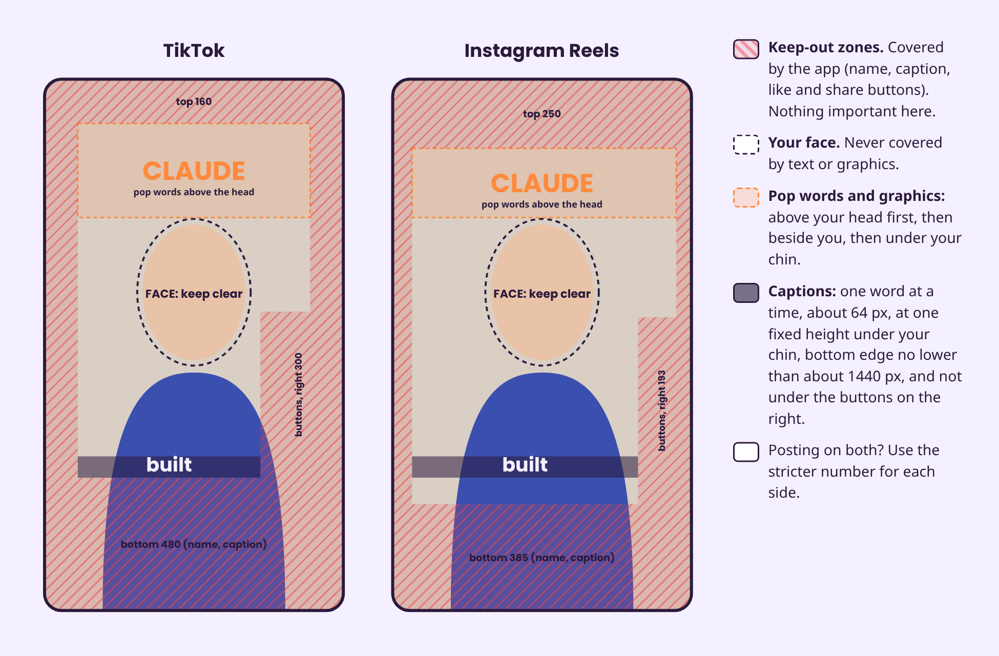
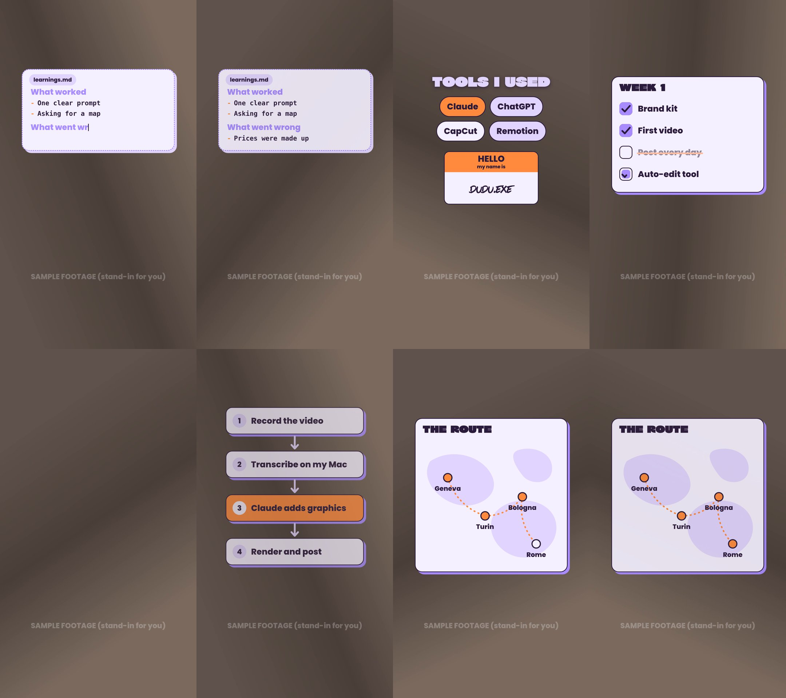
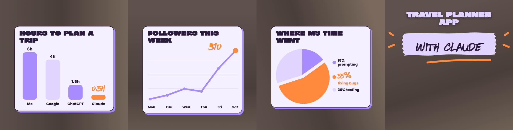
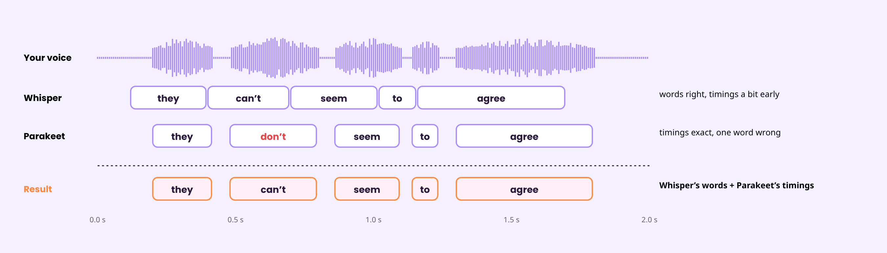

# Animate your videos with Claude and Remotion

**For free, other than a Claude subscription.** How I add animations, effects and word-by-word captions to my short videos just by asking Claude. No video editing app, no paid tools on top of my Claude plan.

**You need:** a paid Claude plan (Pro or Max) and the Claude desktop app (or claude.ai/code in a browser). A GitHub account is only needed in some cases (see Step 1).

**How to read this guide:** each step starts with **What to do** (the actions and the prompts to copy), then **How it works** (the details, if you are curious).

## The 10 steps at a glance

**Picture: Steps 1 to 8 are done once, steps 9 and 10 for every video**



## What you get

- You film yourself talking (vertical video, on your phone).
- Claude writes down every word you say, with the exact moment each word is said.
- Claude adds **captions** that appear word by word at the bottom, plus a few **big "pop" words** in another colour that never cover your face.
- Claude adds **animations** at the right moments: a prompt typing into a box, a big number, a checklist, a 3D effect, a cartoon, and so on.
- You watch it, ask for changes in normal words ("move the number to 0:14"), and get a finished MP4.

You never touch a video editing app. You talk to Claude, Claude changes one text file, and a free tool called Remotion turns that file into your video.

## What it costs

| Item | Cost in my setup | Note |
|---|---|---|
| Claude | My existing paid plan | No extra charge for the cloud computer Claude uses, but it counts toward your plan's usage limits. |
| Remotion (makes the video) | Free for me | Free for individuals and small companies (up to 3 employees). Bigger companies pay. |
| Speech-to-text (Parakeet + Whisper) | Free | Free models. No account or key needed. |
| Lottie animations | Free | Free animations from LottieFiles. |
| Fonts | Free ones work | Google Fonts are free to use in videos. |

Details and sources for each are in [Licences and costs](#licences-and-costs).

## Words you will see

- **Remotion:** a tool that makes videos from code. Instead of dragging clips on a timeline, Claude describes the video in code and Remotion draws it, frame by frame, into an MP4.
- **Render:** turning the project into the finished video file.
- **Cloud session:** Claude working on its own small computer online. It can install tools, run them and send you files. Nothing is installed on your computer.
- **Skill:** a pack of instructions that teaches Claude how to do one kind of task well.
- **timeline.json:** one text file that lists everything in your video (your clip, each caption word, each animation) with its start time and length in seconds. To edit the video, Claude only changes this file.
- **Graphic type:** one reusable animation (for example "big number"). Built once, then reused in any video by adding one line to the timeline.
- **Transcription:** turning speech into text. **Word timings** = when each word starts and ends.
- **Model:** the "brain" file of an AI tool, here the speech-to-text ones.
- **Cut-out:** a copy of your video with the background removed, so things can pass *behind* your head.
- **Safe zones:** the parts of the screen that TikTok or Instagram cover with buttons and text. Animations must stay out of them.

## Step 1: Start a cloud session

### What to do

**Option A (what I use): a Claude project. No GitHub needed.**

1. **Open Projects:** in the Claude desktop app, go to Code, then Projects (if you don't see it, look under More).
2. **Create a new project.** Only the name is required.
3. **Paste this prompt** in the project chat:

```text
I want to animate my short videos (TikTok, Instagram Reels) with Remotion: word-by-word captions, graphics and effects. Start one thread for the whole setup and keep all the files in this project. In that thread, I will paste the prompts of the next steps one by one.
```

4. **Open the thread Claude starts**, and paste the prompts of Steps 2 to 8 there, one at a time.
5. **For each new video later**, ask in the project chat: "Start a thread to edit this video" and attach your video.

**Option B: a normal cloud session. GitHub needed.**

1. **Open Code** in the Claude desktop app.
2. **Pick Cloud:** under the message box, open the environment selector and pick Cloud (not Local).
3. **Pick a GitHub repository.** If you don't have one, create an empty repository with a README on github.com first.
4. **Paste the prompts** of the next steps directly in this session, one at a time.

### How it works

- A cloud session means Claude works on its own computer online: it can install tools, run them, and send you the finished video. Nothing is installed on your computer.
- In a project, Claude starts a cloud session (a "thread") for each task by itself, and your files stay in the project's **Library** between sessions. Claude's docs say projects work with "the files, folders, and Google Drive folders you upload to the project", and GitHub is only needed "if the project will work on code" that lives in a GitHub repository. Note: "Projects are in public beta on Pro and Max plans and rolling out gradually", so you may not have it yet ([projects docs](https://code.claude.com/docs/en/claude-projects.md)).
- In the desktop app, a normal session does not pick Cloud for you: "Before you send your first message, choose the environment, project folder, permission mode, and model in the row under the prompt box." ([desktop docs](https://code.claude.com/docs/en/desktop.md))
- A normal cloud session needs GitHub: "Cloud sessions require a connected GitHub account" and "You'll need a GitHub repository to get started" ([cloud quickstart](https://code.claude.com/docs/en/web-quickstart.md)). Your editor is saved in the repository, so nothing is lost when the cloud computer is wiped.

## Step 2: Add the Remotion skills

### What to do

**Option 1 (fastest): add the Remotion plugin, in one click.** Search "Remotion" in Claude's plugin directory and add the plugin called **Remotion**, by Remotion.

**Option 2: ask Claude to download the Remotion agent skills.** Paste:

```text
Download the official Remotion agent skills from github.com/remotion-dev/skills, save them with my project files so they are kept for the next sessions, and follow them whenever you work on my videos.
```

### How it works

Remotion publishes free "skills": instruction packs that teach Claude how to write good Remotion code ([remotion-dev/skills](https://github.com/remotion-dev/skills)). The plugin in the Anthropic plugin directory is described as "Remotion video creation skills" and contains the same 12 skills (remotion-best-practices, remotion-captions, remotion-create, and so on).

## Step 3: Create your brand guidelines

### What to do

**If you already have brand guidelines** (colours, fonts, a style guide, a Canva brand kit), attach them and paste:

```text
Here are my brand guidelines. Turn them into one brand file for my videos: colours with hex codes, fonts (with a free Google Fonts match for any font I don't have the file for), caption style, animation style and rules. Ask me about anything that is missing.
```

**If you don't have any yet**, paste this prompt and answer Claude's questions:

```text
Help me create simple brand guidelines for my short videos (TikTok, Instagram Reels).
I am not a designer, so guide me: ask me one question at a time and suggest answers
I can pick from.

Ask me about:
- my channel: what it is about, who it is for, and 3 words for how it should feel,
- creators or videos whose look I like (ask me for screenshots),
- colours I like or want to avoid.

Then:
1. Propose 3 colour palettes (5 to 6 colours each, with hex codes and what each
   colour is for: background, text, accent, pop words). Show them as one image so I
   can compare. Check that text stays readable on the backgrounds.
2. Propose 3 font pairs (titles + captions + an optional handwritten font), using
   free Google Fonts only. Show each pair on a sample frame of a vertical video.
3. Propose a caption style: font, size, colour, where on screen, and how pop words
   look (bigger, accent colour).
4. Propose an animation feel (for example playful and bouncy, or calm and clean).
5. When I have picked, write everything into one brand file (colours, fonts with
   their licence, caption style, animation feel, and do / don't rules), and make one
   picture of a sample frame using it.
Keep it simple and explain any design word you use.
```

**Keep this brand file:** the setup prompt in the next step asks for it.

### How it works

Do this before setting up Remotion: every graphic, caption and effect will use these colours, fonts and rules, so your videos look like yours from the first render. Claude asks one question at a time, shows you options as pictures, and only writes the brand file once you have picked.

## Step 4: Set up Remotion with one prompt

### What to do

1. **Paste this prompt as it is.** You don't need to change anything: Claude asks you for what it needs (your brand file, a short test video, where to save the editor).

```text
Set up a Remotion video editor for my vertical short videos (TikTok, Instagram Reels).

Before you start, ask me (one question at a time) for anything you need, for example:
- my brand file (colours, fonts, caption style). If I don't have one, stop and help me
  make one first,
- a short test video of me talking (5 to 10 seconds),
- whether we are in a Claude project or a normal cloud session with a GitHub
  repository (so you know where to save the editor).

1. Skills: use the Remotion skills. If they are not loaded, download them from
   github.com/remotion-dev/skills and follow them.
2. Project: a Remotion project, 1080x1920, 30 fps. Save it where it will not be lost
   when the session ends: in the project's files (Claude project) or in my GitHub
   repository (normal cloud session).
3. One timeline file: make timeline.json the single source of truth. Tracks for video,
   graphics, captions and audio. Each item has an id, a type, a start and a duration in
   seconds, and its own settings. Check the file with a schema so a mistake stops the
   render with a clear message. Every new video = a new timeline file.
4. Brand: copy my brand file into the project (colours, fonts, caption style, rules).
   Use the font files with their licence files. Every time I give feedback on a look
   ("no rotation", "bigger text"), save it as a rule in this file.
5. Layout rules (frame 1080x1920, pixels counted from each edge). Save them in the
   brand file and follow them in every video:
   - Keep-out zones (covered by the app's buttons, name and caption):
     - TikTok: top 160, bottom 480, left 120, right 120, and right 300 from 840 px
       down (the like / comment / share buttons).
     - Instagram Reels: top 250, bottom 385, left 70, right 55, and right 193 from
       860 px down.
     - If I post on both, use the stricter number of each side. Never put text, logos
       or important parts of a graphic in these zones.
   - My face: never cover my face (eyes, mouth) with text or graphics. Find my face in
     the video and place things around it: above my head first, then beside me, then
     under my chin.
   - Captions: one word at a time, appearing when I say it. Bold, about 64 px, in my
     caption colour, centred, at ONE fixed height for the whole video: below my chin,
     with its bottom edge no lower than about 1440 px (above TikTok's bottom zone),
     and never under the buttons on the right.
   - Pop words: max one per caption line, big (100 to 200 px), in my accent colour,
     placed above my head if there is room (between the top zone and 20 px above my
     head), otherwise under my chin. Never on top of the bottom caption.
   - Text size: titles at least 84 px, any other text at least 44 px, so it is
     readable on a phone. Text always straight (no rotation) and readable on its
     background.
   - Busy screens: max 2 graphics at the same time, and the bottom caption always
     stays visible.
   These numbers are estimates from online sources, so render one still with the
   zones drawn on it that I can compare with a screenshot from my phone, and adjust
   them if I ask.
6. My footage: never filter, grade or recolour my original video. Effects may move,
   crop, frame or cover it, nothing else. If a clip is an iPhone HDR video (it would look
   orange in the render), only relabel its colour information to standard (bt709)
   without changing the pixels.
7. What comes next (don't build these now): after the setup, we will do these steps
   one at a time. When I start each one, ask me these questions first:
   - Graphics library: what I usually talk about and show in my videos, so you can
     suggest which graphics I need beyond the must-haves.
   - Reel effects: which effects I like (I may send screenshots), and whether I am OK
     with you making a cut-out of me (my video with the background removed).
   - Motion animations: which ones I want and where I would use them.
   - Lottie animations: the animation files I downloaded and where they should go.
   - Transcription: my video, the language I speak, and the correct spelling of names
     or brands I mention.
   - Captions and animations: which pop words I want, and my OK on the list of
     animations and their times before you build anything.
8. Rendering: add a preview command and a render command. If the render fails because
   Remotion cannot download its browser, use the Chrome already installed on the cloud
   computer.
9. Checking: with every render, also make 4 to 6 stills. Look at them yourself and check
   them against my brand rules and the safe zones before sending me anything.
10. Test: render a 5-second test video with my test clip and one word on screen in my
    brand style, and send me the video and the stills.
```

2. **Answer Claude's questions.**
3. **Check the 5-second test video** and the still with the safe zones drawn on it. Compare it with a screenshot from your phone and ask for changes if needed.

### How it works

**One timeline file.** Every new video is just a new timeline, and every animation you build once can be reused forever. Claude writes the timeline for you, you never have to. One line of it looks like this:

```json
{ "id": "prompt-1", "type": "promptBox", "start": 0.3, "duration": 6.4,
  "props": { "prompt": "Make me a travel planner with a map and a budget.", "highlight": "travel planner" } }
```

**Picture: timeline.json shown as tracks over 10 seconds**



**The layout rules.** The numbers in the prompt are the ones I use. They are estimates from online sources and a screenshot of my own phone, not official numbers.

**Picture: Where things go on the screen on TikTok and Instagram**



**The fixes in the prompt** come from my own tests: iPhone HDR videos looked orange until the colour information was relabelled, and Remotion sometimes could not download its browser in the cloud. Before filming, you can also turn off **HDR Video** in the iPhone camera settings, so no relabelling is needed.

## Step 5: Build your graphics library

### What to do

1. **Paste the must-have prompt below.** It builds a first set that covers most talking videos (my choice of the most useful ones).

```text
Build the must-have graphics for my video editor, in my brand style, each as a
reusable graphic type I can place in timeline.json:
1. promptBox: a prompt types into a box, one phrase gets a marker highlight, the send
   button is pressed, a short handwritten note appears.
2. bigWord: one word, very big, bounces in and out.
3. bigNumber: a big number counts up to its value, a label appears underneath.
4. kineticLine: a key sentence builds on screen word by word.
5. callout: a handwritten note with a hand-drawn arrow or circle pointing at a spot.
6. checklist: a card with a title and items that get ticked one by one.
7. exeWindow: an app window opens and shows a screenshot of a result.
8. transition: a quick coloured swipe across the screen between two parts.
Before you start, ask me what I usually talk about and show, and suggest up to 3
extra graphics from my topics. Then render a preview video and stills of each
graphic, check the stills against my brand rules and the safe zones, and send them.
```

2. **Answer Claude's question about your topics**, then check the preview video and stills.
3. **Give feedback in plain words** ("no rotation", "bigger text"). Claude saves each rule in your brand file, so the next graphics follow it.
4. **Whenever you want more, paste a prompt from the full list below**, one (or a few) at a time. Replace the example text with yours.

### How it works

Each graphic is built **once** as a reusable "graphic type", then placed in any video by adding one line to the timeline. Graphics that pass behind you (sticker outline, floating cards) use the cut-out of you, which is set up in Step 6. After that, for each new video, ask:

```text
Make a cut-out of me from this clip (my video with the background removed) with Robust Video Matting running on CPU, and save it as a transparent video for the graphics and effects.
```

It took about 1.5 minutes for an 8-second clip.

The pictures below show some of my graphics on stand-in footage.

**Picture: My graphics, screens and objects**



**Picture: My graphics, numbers and charts**



### Full list of graphics

#### Text

| Graphic | What it looks like | Prompt |
|---|---|---|
| Prompt box | A prompt types into a box, one phrase gets a marker highlight, the send button is pressed, a handwritten note appears | "Create a graphic type `promptBox`: a prompt types into a box, one phrase gets a marker highlight, the send button is pressed, and a short handwritten note appears. Settings: prompt, highlight, typing speed, send time, note." |
| Search bar | A search types in, then the search button is pressed | "Create a graphic type `searchBar`: a search bar where a query types in letter by letter, then the search button is pressed. Settings: query, typing speed." |
| Big word | One word, very big, bounces in | "Create a graphic type `bigWord`: one word, very big, bounces in and out. Settings: word, colour, size, position, optional glow." |
| Kinetic line | A sentence builds word by word | "Create a graphic type `kineticLine`: a key sentence builds on screen word by word, with a bounce on each word. Settings: text, timing per word." |
| Strike-through | A word gets crossed out with a marker line | "Create a graphic type `strikeThrough`: a word or line appears, then a hand-drawn marker line crosses it out. Settings: text, colour." |
| Shrink to dot | Text shrinks into a dot and disappears | "Create a graphic type `shrinkToDot`: text appears, then shrinks into a small dot and disappears." |
| Hook headline | A short hook line above a big stacked headline, for the first seconds | "Create a graphic type `hookHeadline`: a handwritten hook line at the top with small rays, and a big stacked headline in capitals below it, for the first 2 seconds of a talking video. Settings: hook, headline lines." |
| Handwritten call-out | A handwritten note with an arrow or circle | "Create a graphic type `callout`: a handwritten note with a hand-drawn arrow or circle pointing at a spot. Settings: text, arrow or circle, target position." |
| Brush highlight | A handwritten phrase on a brush stroke, with small rays and an underline | "Create a graphic type `brushHighlight`: a handwritten phrase on a soft brush stroke, with small dash rays and a hand-drawn underline, optional bold lines above it. Settings: phrase, bold lines." |

#### Numbers and charts

| Graphic | What it looks like | Prompt |
|---|---|---|
| Big number | A number counts up, a label underneath | "Create a graphic type `bigNumber`: a big handwritten number counts up to its value, a label appears underneath. Settings: value, prefix/suffix, label." |
| Bar chart | Bars grow in | "Create a graphic type `barChart`: a simple bar chart on a card, bars grow in one after another with their values. Settings: title, labels, values." |
| Line chart | A line draws in | "Create a graphic type `lineChart`: a line chart on a card, the line draws in from left to right, the last point pops. Settings: title, points." |
| Pie chart | Slices sweep in | "Create a graphic type `pieChart`: a pie chart on a card, slices sweep in one by one with a legend. Settings: title, slices (label, value)." |

#### Screens and objects

| Graphic | What it looks like | Prompt |
|---|---|---|
| Phone messages | Chat bubbles pop in on a phone, with typing dots | "Create a graphic type `phoneMessages`: a generic phone (not a copy of any brand's design) with a contact name at the top; chat bubbles pop in one by one, with typing dots before each reply. Settings: contact, messages (who, text, time)." |
| Toggles | Settings-style switches flip on one after another | "Create a graphic type `toggles`: a card of settings-style switches that flip on one after another. Settings: labels, which ones turn on." |
| Calendar | A month grid, days get ticked or events pop in | "Create a graphic type `calendar`: a month grid; chosen days get ticked or small events pop in. Settings: month, ticked days, events." |
| App window | A screenshot of what the AI made, inside a window | "Create a graphic type `exeWindow`: an app window with a title bar that opens and shows a screenshot of a result. Settings: title, image." |
| File card | A notes file card with lines typing in | "Create a graphic type `fileCard`: a notes card with a file name (like notes.md) and lines that type in. Settings: file name, lines." |
| Tool pills | Pills with the names of the tools used, plus a name tag | "Create a graphic type `toolPills`: rounded pills with tool names pop in, plus an optional 'hello my name is' tag. Settings: tools, name." |
| Checklist | Items get ticked one by one | "Create a graphic type `checklist`: a card with a title and items that get ticked one by one. Settings: title, items." |
| Flowchart | Boxes and arrows draw in | "Create a graphic type `flowchart`: steps in boxes, connected by arrows that draw in one after another. Settings: steps." |
| Map route | A dashed line travels between pins | "Create a graphic type `mapRoute`: a simple drawn map; a dashed line travels between pins, place names appear. Settings: places." |
| Clock | A clock hand sweeps a coloured wedge, with a handwritten time label | "Create a graphic type `clock`: a clock whose hand sweeps and fills a coloured wedge, with a handwritten time label. Settings: from, to, label." |
| Taped photo | A photo or clip drops in, held by tape | "Create a graphic type `tapedPhoto`: a photo or short clip drops in at a small angle and gets taped on. Settings: image or video, caption." |
| Paper note | Torn lined paper, handwriting writes on | "Create a graphic type `paperNote`: a piece of torn lined paper slides in and handwriting writes on it line by line. Settings: lines." |
| Thought bubble | A paper cut-out thought bubble with stickers | "Create a graphic type `thoughtBubble`: a paper cut-out thought bubble pops in with small stickers (tag, star, burst) and a short text. Settings: text, stickers." |
| Folder | A folder opens, documents slide in, its name types | "Create a graphic type `folderFiles`: a folder appears, its name types in, and document cards slide into it. Settings: folder name, files." |
| Disagree | Two sticker characters arguing, speech bubbles, a lightning bolt | "Create a graphic type `disagree`: two flat sticker characters drawn from scratch lean in and out of an argument, speech bubbles pop one after the other, a lightning bolt flickers between them." |
| Release page | A carousel slide turned into an animated video page | "Create a graphic type `releasePage`: one carousel slide as a video page: a header pill, a title, a window with logo, headline, rows and stat cards, a 'why it matters' card and a source line, each appearing one at a time with more reading time for longer text. Settings: all texts, logos." |

#### Video helpers

| Graphic | What it looks like | Prompt |
|---|---|---|
| Angled screen | Your screen recording on a tilted panel next to you | "Create a graphic type `angledScreen`: a screen recording on a tilted, slightly see-through panel next to or over me. Settings: video, side, angle." |
| Transition | A quick swipe between parts | "Create a graphic type `transition`: a quick coloured swipe across the screen to move between parts." |
| Picture-in-picture | A second clip in a rounded frame | "Create a graphic type `insetClip`: a second video in a rounded frame with a light border, popping in at a corner. Settings: video, position, size." |
| Sticker outline | A light outline around you or an object, like a sticker | "Create a graphic type `stickerOutline`: a thick, very light outline traced around a cut-out person or object, like a sticker. Use the cut-out video from the background removal step." |
| Floating cards | Cards floating around you, some behind you | "Create a graphic type `floatingCards`: small cards with text or images float around me, some behind me and some in front. Use the cut-out of me." |
| Captions | Word-by-word captions at the bottom, with big pop words | "Make the captions track: one word at a time at the bottom, each word appears when it is said, in my caption font and colour; selected pop words also appear big in my accent colour, above my head or under my chin, never over my face." |

## Step 6: Add reel effects

### What to do

1. **Paste the must-have prompt below.** It sets up what the effects need and builds a first set (my choice: a mix of hook, emphasis and "behind me" effects).

```text
Set up reel effects for my video editor:
1. Create a graphic type `reelEffect` with a setting `effect` that picks the effect.
   Use my clip and my brand colours. Never recolour my footage.
2. Cut-out: make a copy of my clip with the background removed (Robust Video Matting
   on CPU), saved as a transparent video, so things can pass behind me.
3. Face tracking: find my face every 0.1 s (OpenCV), for effects that follow my face.
4. Build these must-have effects:
   - gridDive: a wall of small tiles; the camera dives into the middle tile, which
     becomes my live video (a hook for the first second).
   - digitalZoom: quick punch-in zooms on my face to stress a word (crop only).
   - screenInScreen: the camera pulls back and my video plays on a drawn laptop.
   - pullBackReveal: the camera pulls back to show my video inside a made-up video
     editor window with a timeline.
   - titleOrbit: a ring with my title circles my head; the back half passes behind it.
   - depthUI: app windows (a chat with a prompt, a code window, a progress bar) float
     around me, some behind my head.
   - beforeAfter: a line wipes across; one half "Before", the other half a clean
     stage "After", me in front.
   - shatter: the picture cracks and breaks into pieces that fly away, showing the
     next shot.
Before you start, ask me which effects I like (I may send screenshots) and whether I
am OK with you making a cut-out of me. Then render one demo video of all the effects
with my clip, plus stills, and tell me which ones are only partly done.
```

2. **Say which effects you like** and whether you are OK with a cut-out of you, then check the demo video.
3. **Whenever you want more, paste a prompt from the full list below.**

### How it works

These are bigger, full-screen effects that change how your video itself looks: the camera moves, zooms or turns, the shot breaks, or things pass behind you. Some need a **cut-out** of you (your video with the background removed) so things can pass behind your head, and some follow your face with **face tracking**. The names come from public lists posted by **@charliehills** ("20 video effects for Claude") and **@tenfoldmarc** ("16 video effects claude can create") on Instagram. I only used the names and screenshots as inspiration: no footage, code or branding of theirs. Claude built **our own versions**.

### Full list of effects

#### Effects that work with any clip

| Effect | What it looks like | Prompt |
|---|---|---|
| Grid Dive | A wall of small tiles; the camera dives into the middle tile, which is your live video | "Add reel effect `gridDive`: a wall of small tiles (stills of my clip and coloured cards); the camera dives into the middle tile, which becomes my live video." |
| Magnifying Lens | A magnifying glass glides in and shows a 2x close-up of what is under it | "Add reel effect `magnifyingLens`: a round lens with a dark handle glides in and shows a 2x close-up of what is under it. Setting: where the lens stops." |
| Portal | A glowing ring with spinning spirals opens; you are seen through it, then it widens until you fill the screen | "Add reel effect `portal`: a glowing ring opens with spinning spirals, I am seen through it, then the ring widens until I fill the screen." |
| Infinite Zoom | A small framed copy of your video in a corner; the camera keeps diving into it, endlessly | "Add reel effect `infiniteZoom`: a small white-framed copy of my video sits in the top right; the camera dives into it again and again." |
| Cube Spin | The shot turns like the side of a cube to show the next shot | "Add reel effect `cubeSpin`: the shot turns in 3D like a cube to show the next clip on its side. Settings: next clip." |
| Screen in Screen | The camera pulls back and your video plays on a laptop | "Add reel effect `screenInScreen`: the camera pulls back and my video is playing on a drawn laptop." |
| Tile Tunnel | A 3D corridor of white tiles; the camera flies down it to your video | "Add reel effect `tileTunnel`: a 3D corridor of white tiles with coloured lines; the camera flies down it to my video at the end." |
| Phone Fan | Your video on a phone, more phones fan out behind it like playing cards | "Add reel effect `phoneFan`: my video plays on a phone; four more phones fan out behind it showing other images (for example my past covers)." |
| Shatter | Cracks appear, the picture breaks into pieces that fly away, showing the next shot | "Add reel effect `shatter`: white cracks appear, then the picture breaks into about 48 pieces that fly out and fall, showing the next shot behind." |
| Pull-Back Reveal | The camera pulls back to show your video inside a made-up editing app with a timeline | "Add reel effect `pullBackReveal`: the camera pulls back and my video is inside a made-up video editor window with clips, a sound wave and a moving playhead. Not a real app." |
| Shutter snapshots | Three snapshots of earlier moments snap on, each with a camera flash | "Add reel effect `shutterStrike`: three instant-photo snapshots of earlier moments snap on at the top, each with a white camera flash." |
| Digital zoom | Quick punch-in zooms on your face to stress a word | "Add reel effect `digitalZoom`: quick punch-in zooms on my face to stress a word (crop only, no filter)." |
| Phone mockup | Your video plays in one floating phone | "Add reel effect `phoneMockup`: my video plays inside one phone that floats gently on a coloured stage." |
| Zoom-Through | The camera rushes into your face with speed lines and comes out in the next shot | "Add reel effect `zoomThrough`: the camera rushes into my face with white speed lines and comes out in the next clip." |
| Spotlight | The room goes dark and a round light follows your face | "Add reel effect `spotlight`: the room goes dark and a round light opens on my face and follows it." (It darkens your footage around the face.) |
| Paper cut | The shot tears apart like paper, the next shot is underneath | "Add reel effect `paperCut`: the shot tears apart like paper and the next clip is underneath." |

#### Effects that use the cut-out (something passes behind you)

| Effect | What it looks like | Prompt |
|---|---|---|
| Title Orbit | A ring with your title circles your head; the back half passes behind it | "Add reel effect `titleOrbit`: a ring with my title in letters circles my head like a halo; the back half passes behind my head. Setting: title (short)." |
| Clone Room | Six copies of you pop in behind you, smaller and slightly delayed | "Add reel effect `cloneRoom`: six copies of me pop in behind me, smaller and further back, each a quarter of a second late." |
| Frame Break | A tilted photo frame drops in and your head breaks out over the top | "Add reel effect `frameBreak`: a tilted white instant-photo frame drops in, shakes, and my head breaks out over its top edge." |
| Depth UI | App windows float around you, some behind your head | "Add reel effect `depthUI`: a chat window with a prompt behind my head, a dark code window, a terminal with a progress bar and a 'Reel ready ✓' pill in front, all drifting gently. Setting: prompt text." |
| Vertigo | You stay the same size while a grid tunnel behind you rushes toward the camera | "Add reel effect `vertigo`: I stay the same size while a drawn grid tunnel behind me rushes toward the camera (the film 'Vertigo' trick)." |
| Ribbon Wrap | Two scrolling text ribbons wrap around you, one behind your head, one across your chest | "Add reel effect `ribbonWrap`: two scrolling text ribbons wrap around me, one behind my head and one in front across my chest. Setting: text." |
| Head Pop Out | Your video in a rounded card; your head rises out of the top of the card | "Add reel effect `headPopOut`: my video in a rounded card on a coloured stage; my head rises out of the top of the card." |
| Assistant beside me | A chat window behind your head with your command and "Done." | "Add reel effect `assistantBeside`: an assistant chat window behind my head showing my command and 'Done.', plus a small app tile. Settings: window title, command." |
| Typewriter wall | Your background becomes a wall of typed words, one word boxed in colour, you in front | "Add reel effect `typewriterWall`: my background becomes a wall of words typing in, one word boxed in my accent colour, me in front." |
| Reel fan | Your past covers fly out and float behind you | "Add reel effect `reelFan`: my past covers fly out and float behind me. Setting: images." |
| Before / After | A line wipes across: left half your real room ("Before"), right half a clean stage ("After") | "Add reel effect `beforeAfter`: a white line wipes across; the right half becomes a clean grid stage, with 'Before' and 'After' pills, me in front." |
| Headline wall | Torn newspaper clippings pop up around you, the big one has your headline | "Add reel effect `headlineWall`: torn paper clippings pop up around me (some behind me), the big one in front has my headline with a highlight. Setting: headline." |
| Green screen | Your room is swapped for a new background | "Add reel effect `greenScreen`: my room is swapped for a new background (a picture or a coloured stage), I stay in front." |
| UI world | You stand inside a giant app screen that drifts past behind you | "Add reel effect `uiWorld`: I stand inside a giant made-up app screen that slowly drifts past behind me." |
| Doodle boil | Chalky hand-drawn outlines around you wiggle, with squiggles and circles | "Add reel effect `doodleBoil`: chalky hand-drawn outlines trace around me and wiggle like hand-drawn animation, with squiggles and circles." |

## Step 7: Add motion animations

### What to do

1. **Paste the must-have prompt below** (my choice of the most useful ones for "how I did it" videos).

```text
Create a graphic type `motionAnim` with a setting `kind`, in my brand colours on light
backgrounds, with an option to play it over my video (transparent background).
Build these must-have animations:
- numberRoll: digits roll like a slot machine to a value; bars grow underneath.
- buttonPress: a cursor presses a "Publish" button, it fills and turns into "Posted ✓".
- confettiBurst: a check badge pops and confetti bursts out.
- cardsShuffle: a stack of cards; the back card swoops to the front, over and over.
- particlesLogo: a cloud of dots flies together into my logo shape.
Before you start, ask me where I would use them. Then render a demo video and stills.
```

2. **Check the demo video and stills.**
3. **Whenever you want more, paste a prompt from the full list below.**
4. **To see everything you have built**, paste:

```text
Render one demo video with every graphic, effect and animation, 3 seconds each, with the name on screen.
```

### How it works

Short, polished animations that work on their own or over your video, without changing your video itself. Liquid Glass, Comment bubble and Sticky text came from the effects lists, but they are animated graphics on top of your video, so they are here. The names come from Charlie Hills' carousel "Claude Motion Physics: 16 premium animations you can clone". Ours are our own versions.

### Full list of motion animations

| Animation | What it looks like | Prompt |
|---|---|---|
| Particles to logo | A cloud of dots flies together into a logo shape | "Add motion animation `particlesLogo`: a cloud of dots flies together into my logo shape." |
| Gradient flow | Soft colour bands flowing like silk | "Add motion animation `gradientFlow`: soft colour bands flowing like silk." |
| Glass tilt | A frosted glass card tilts in 3D with a light sheen sliding over it | "Add motion animation `glassTilt`: a frosted glass card tilts in 3D with a light sheen sliding over it." |
| Globe arcs | A dotted globe spins and arcs draw between places | "Add motion animation `globeArcs`: a dotted globe spins and arcs draw between places." |
| Shape morph | A soft blob keeps changing shape and bounces | "Add motion animation `shapeMorph`: a soft blob keeps changing shape and bounces." |
| Grid wave | A grid of dots in perspective with a wave rolling through | "Add motion animation `gridWave`: a grid of dots in perspective with a wave rolling through." |
| Cards shuffle | A stack of cards; the back card swoops to the front, again and again | "Add motion animation `cardsShuffle`: a stack of cards where the back card swoops to the front, over and over." |
| Number roll | Digits roll like a slot machine to the value; bars grow underneath | "Add motion animation `numberRoll`: digits roll like a slot machine to the value, bars grow underneath. Setting: value." |
| Ribbon twist | Many thin lines form a ribbon that twists like a DNA strand | "Add motion animation `ribbonTwist`: many thin lines form a ribbon that twists like a DNA strand." |
| Liquid merge | Two drops drift together and melt into one | "Add motion animation `liquidMerge`: two drops drift together and melt into one (goo effect)." |
| Phone explode | A phone's layers lift apart, then click back together | "Add motion animation `phoneExplode`: a phone's layers lift apart (exploded view), then click back together." |
| Orbit | A glowing planet with rings and a small moon going round | "Add motion animation `orbit`: a glowing planet with rings and a small moon going round it." |
| Button press | A cursor presses a button, it fills and turns into "Posted ✓" | "Add motion animation `buttonPress`: a cursor presses a 'Publish' button, it fills and turns into 'Posted ✓'." |
| Confetti burst | A check badge pops and confetti bursts out | "Add motion animation `confettiBurst`: a check badge pops and confetti bursts out, with the text 'You're live'." |
| Comment bubble | A viewer comment card pops in and gets a heart | "Add motion animation `commentBubble`: a viewer-style comment card pops in and gets a heart. Setting: comment text." |
| Liquid Glass | A frosted glass bar with four icons slides up; a glass bubble hops between icons | "Add motion animation `liquidGlass`: a frosted glass bar slides up with four simple icons; a glass bubble hops from icon to icon and the active icon changes colour." (Ours is a blur, it does not bend the picture like real liquid glass. It plays over your video and does not change it.) |
| Sticky text | A label sticks next to your head and follows you | "Add motion animation `stickyText`: a coloured label sticks next to my head and follows me as I move (uses face tracking). Setting: text." |

## Step 8 (optional): Add free Lottie animations

### What to do

1. **Download a free animation** from [LottieFiles](https://lottiefiles.com) as **Lottie JSON** (or `.lottie`).
2. **The first time, attach the file** and paste:

```text
Add a graphic type `lottie` using @remotion/lottie, with settings: file, position, size, loop, speed. Ask me where this animation should go in my video, then render a test.
```

3. **Every time after, attach the file** and say where it goes, for example:

```text
Add this robot animation at 0:02 for 3 seconds, above my head.
```

4. **Keep a small list** of each animation you use (name, creator, link).

### How it works

Lottie files are small cartoon-style animations that stay sharp at any size. The LottieFiles licence allows commercial use; credit is optional but encouraged (see [Licences](#licences-and-costs)).

## Step 9: Transcribe your video

### What to do

1. **Attach your video and paste this prompt:**

```text
Here is my video. Transcribe it in the cloud with free models: copy only the audio to a 16 kHz WAV, get word timings from NVIDIA Parakeet TDT 0.6B v2 (int8, via pip sherpa-onnx, model from the k2-fsa/sherpa-onnx GitHub releases), get the words from Whisper large-v3-turbo (also via sherpa-onnx, in pieces of max 25 s cut at pauses). Keep Whisper's words with Parakeet's timings. If a download is blocked by the cloud network settings, tell me which website is blocked and look for the same model on GitHub. Ask me which language I speak and how to spell names or brands I mention. Give me a transcript table (start, end, text) and list every word where the two models disagree.
```

2. **Read the transcript table** and correct any names or wrong words.
3. **Optional: cut pauses and retakes.** If your video still has pauses and retakes, paste:

```text
Using the word timings, cut pauses longer than 0.45 s and earlier tries of repeated sentences (keep the last take). Show me the cut list first. Only cut, don't change the picture, and add a tiny sound fade at each cut so there is no click. Then move the word timings to match the cut video.
```

   You get a list of the cuts (time, reason, what was said) before anything is cut, and can say "keep cut 3".

### How it works

Claude needs every word you say, with the exact time of each word. Two free models run on Claude's cloud computer:

- **NVIDIA Parakeet** gives very precise **timings**, but got a few words wrong on my clips (it heard "don't" instead of "can't", and "This visu" instead of "Bisou bisou").
- **OpenAI Whisper (large-v3-turbo)** got **every word right** (even with my French accent), but after a pause it showed the next word a bit too early.

So we use **Whisper's words with Parakeet's timings**.

**Picture: Whisper's words + Parakeet's timings, on "they can't seem to agree"**



What Claude does:

1. Copies **only the sound** of your video into a small audio file. Your video is not changed.
2. Runs **Parakeet** to get the timing of each word (about 8 seconds for an 8-second clip).
3. Runs **Whisper** to get the words. Long videos are cut into pieces of 25 seconds or less, at pauses.
4. **Combines** the two: Whisper's words, placed at Parakeet's times.
5. Gives you the **transcript table** and lists every place where the two models heard something different.

**Why GitHub?** The cloud computer only reaches websites its network settings allow ([cloud environments docs](https://code.claude.com/docs/en/cloud-environments.md)). In my setup, the Hugging Face model files were blocked, but the same models on GitHub worked.

**Backup: transcribe on your own computer.** Remotion has a tool that runs Whisper on your own computer (`@remotion/install-whisper-cpp`; its docs say: "With Whisper.cpp, you can transcribe audio locally on your machine."). Ask Claude to prepare it for you. It worked on my MacBook in under a minute for a short clip.

**Cutting pauses and retakes:** because every word has a time, Claude can find pauses longer than about half a second, earlier tries when you repeat a sentence (it keeps the **last** try), and restarts in the middle of a sentence.

## Step 10: Make the captions and place the animations

### What to do

1. **Pick the pop words.** Paste:

```text
From the transcript, suggest the pop words (max one per line).
```

2. **Agree on the animations before anything is built.** Paste:

```text
Read the transcript and propose which graphics, effects and animations to use and when, for example "0:03 prompt box with ...", "0:12 big number 5". Tell me where nothing fits. Don't build anything until I approve.
```

3. **Approve or change the plan**, then paste:

```text
Write the timeline: word-by-word captions at the bottom at one fixed height, pop words big above my head or under my chin (never over my face, use face tracking), and the approved animations. Start each word exactly when my voice starts. Follow my layout rules. Render the video and 6 stills, check them, then send me the video.
```

4. **Watch the video and ask for changes** in plain words, for example "Move the big number to 0:14" or "Make the window bigger and put it above my head".

### How it works

Claude turns each change into an edit of `timeline.json` and renders a new version. Keep every version (v01, v02...) so you can go back. Claude checks the stills itself against your brand and layout rules before sending the video, so many problems are caught before you watch.

## Licences and costs

Checked on 2026-10-24. Licences can change, so check the links before using this for a business. This is not legal advice.

| What | Cost / licence | Key terms (quoted) | Source |
|---|---|---|---|
| Claude | Paid plan | Cloud sessions "are available on Pro, Max, and Team plans" and count "toward your plan's usage limits ... there's no separate charge for the cloud VM". | [Claude Code docs](https://code.claude.com/docs/en/claude-code-on-the-web) |
| Remotion | Free for some, paid for bigger companies | Free if you are "an individual", "a for-profit organization with up to 3 employees", "a non-profit or not-for-profit organization". Otherwise "You are required to obtain a Company License". "In Remotion 5.0, the license will slightly change." | [Remotion LICENSE.md](https://github.com/remotion-dev/remotion/blob/main/LICENSE.md) |
| Remotion skills | Not verified | I could not find a licence file in the repository. | [remotion-dev/skills](https://github.com/remotion-dev/skills) |
| NVIDIA Parakeet TDT 0.6B v2 | Free, CC-BY-4.0 | "This model is ready for commercial/non-commercial use." "Use of this model is governed by the CC-BY-4.0 license." (CC-BY asks you to credit the creator.) | [Model card](https://huggingface.co/nvidia/parakeet-tdt-0.6b-v2) |
| OpenAI Whisper | Free, MIT | "Whisper's code and model weights are released under the MIT License." | [openai/whisper](https://github.com/openai/whisper) |
| sherpa-onnx | Free, Apache 2.0 | | [LICENSE](https://github.com/k2-fsa/sherpa-onnx/blob/master/LICENSE) |
| LottieFiles free animations | Free, Lottie Simple License | Allowed "including for commercial purposes". "Use of Files without attributing the creator(s) of the Files is permitted under this license, though attribution is strongly encouraged." Not allowed: "collect or compile Files from LottieFiles to replicate or develop a similar or competing service." | [Lottie Simple License](https://lottiefiles.com/page/license) |
| lottie-web | Free, MIT | | [LICENSE.md](https://github.com/airbnb/lottie-web/blob/master/LICENSE.md) |
| Robust Video Matting (cut-out) | Free, GPL-3.0 | | [LICENSE](https://github.com/PeterL1n/RobustVideoMatting/blob/master/LICENSE) |
| OpenCV (face tracking) | Free, Apache 2.0 | | [LICENSE](https://github.com/opencv/opencv/blob/4.x/LICENSE) |
| FFmpeg (audio, conversions) | Free, LGPL v2.1+ | "Most files in FFmpeg are under the GNU Lesser General Public License version 2.1 or later" | [LICENSE.md](https://github.com/FFmpeg/FFmpeg/blob/master/LICENSE.md) |
| Fonts | Google Fonts are free (SIL Open Font License) | Check the licence of any other font: some are "personal use only". | [Noto Sans OFL](https://github.com/notofonts/latin-greek-cyrillic/blob/main/OFL.txt) |

**Good to know (limits):**

- A full edit uses a good part of your Claude plan's usage. I did not measure how much.
- Transcription was tested in English only, on my own voice. Parakeet v2 is an English model.
- Cutting pauses and retakes was tested on one test video only, so check the cut list carefully.
- Some effects are simpler versions (marked in the tables).
- The safe-zone sizes are estimates, not official numbers.
