# Sort My Media with Claude

Your photos, videos and sounds, sorted for free.

Free means no extra app or subscription to buy: you only need your Claude account.

**How this guide works:** read the first part, pick your route (A1: Claude Code in the terminal, A2: Claude Code in the desktop app, or B: the normal Claude chat in the desktop app), then follow only the steps for your route. The last part (what can go wrong, folder details) is the same for everyone.

Everything you type or paste is shown in an orange box, like `sort my media`. Buttons and menus you click are in **bold**. Notes that explain things are in a lilac "Good to know" box.

## What it does, in one minute

You put your files in one folder. Claude looks at each file and moves it into tidy folders by type: **Pictures**, **Videos**, **Sounds** and **Other**, each with smaller folders inside (like Photos of people, B-roll or Music), plus **Not sure** for anything unclear. The full list is at the end: [The folders you get](#the-folders-you-get-full-details).

- **It never deletes anything** and never changes what is inside a file.
- **It keeps your file names.** It only moves files.
- **You see the plan first**, and you can undo everything with one sentence.

## What you need before you start (5 minutes)

1. **A computer**: a Mac or a Windows PC. You run this from your computer, not from a phone or iPad.
2. **A Claude account.** Route A1 and A2 (Claude Code) need a paid plan (Pro or higher), see [Claude plans](https://claude.com/pricing).
3. **The skill file**: a ZIP file called sort-my-media. Download it here: [sort-my-media.zip](https://github.com/duduexe/ai-lab/raw/main/05_sort_my_media/sort-my-media.zip). It lands in your Downloads folder.
4. **Your files in a folder called Sort me.** Make a new folder called **Sort me** and put your files in it. It can be a normal folder on your computer, or a folder in iCloud Drive, Dropbox, Google Drive or OneDrive that appears in Finder (Mac) or File Explorer (Windows).

    > **Good to know:** files filmed on your phone need to be moved to that folder first (AirDrop, iCloud or a cable). In a cloud folder, make sure the files are **downloaded on the computer**, not only stored online ("Keep downloaded" in iCloud Drive, "Make available offline" in Dropbox or Google Drive). Moving files there also moves them in the cloud copy.

> **Tip:** for your very first try, use a small mix (20 to 30 files), and work on a COPY of your files until you trust the result.

## Choose your route

All three routes do the same sorting. Click a route to jump to its steps.

| | Route A1 | Route A2 | Route B |
|---|---|---|---|
| What it is | **Claude Code** in the **terminal** (a window where you type commands) | **Claude Code** inside the **Claude desktop app**, in the Code area (the **</>** button) | The **normal Claude chat** (the speech bubble) in the **Claude desktop app** |
| Best for | You don't mind typing a few commands | You have a paid plan and prefer buttons | You prefer the chat you already use, or you don't have a paid plan |
| Plan needed | Paid (Pro or higher) | Paid (Pro or higher) | Any plan, with code execution switched on |
| Where your files are read | On your computer | On your computer | On your computer if you paste the folder path (on Anthropic's servers if you use Add folder) |
| Speech detection setup | Nothing to do, Claude installs it | Nothing to do, Claude installs it | Allow 4 websites in Settings first |
| Time the first time | About 30 minutes | About 15 minutes | About 20 minutes |

> **Good to know:** menu names in apps can change. If a button has a slightly different name, look for the closest one.

## Route A1: Claude Code in the terminal

Total the first time: about **30 minutes**. Next times: about **2 minutes of your time**. You need a paid Claude plan (Pro or higher), see [Claude plans](https://claude.com/pricing).

| Step | What you do | Time |
|---|---|---|
| 1 | Open the terminal | 1 min |
| 2 | Install Claude Code | 5 to 10 min |
| 3 | Add the skill | 5 min |
| 4 | Open the terminal in Sort me and start Claude Code | 2 min |
| 5 | Answer Claude's questions | 1 min |
| 6 | Check the plan and say go | 1 to 5 min |

### Step 1: learn to open the terminal (1 minute)

> **Good to know:** the terminal is a window where you type commands. Never used one? Anthropic's official guide with pictures: [terminal guide](https://code.claude.com/docs/en/terminal-guide).

1. **Open the terminal.**
    - **Mac:** press **Cmd + Space** to open Spotlight, type `Terminal`, press **Enter**. Or open **Finder > Applications > Utilities** and double-click **Terminal**.
    - **Windows:** click **Start** (or press the **Windows key**), type `PowerShell`, click **Windows PowerShell**. Or right-click **Start** and choose **Terminal** (Windows 11) or **Windows PowerShell** (Windows 10).
2. **Find the blinking cursor.** A window opens with a line ending in a blinking cursor. That is where you paste commands: **Cmd + V** on a Mac, **Ctrl + V** or right-click on Windows. Press **Enter** to run a command.

### Step 2: install Claude Code (5 to 10 minutes, once)

1. **Open the terminal** (Step 1).
2. **Copy the command for your computer, paste it, and press Enter.**
    - **Mac:**

        ```
        curl -fsSL https://claude.ai/install.sh | bash
        ```

    - **Windows (PowerShell):**

        ```
        irm https://claude.ai/install.ps1 | iex
        ```

    You can also copy it from the official page with its copy button:

    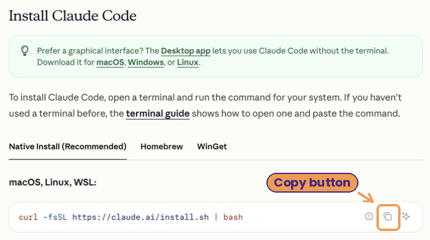
    *Picture: the official Claude Code install page, Native Install tab. The grey box holds the Mac command; the copy button on its right copies it. Scroll down on that page for the Windows command.*

3. **Wait, then close the window.** It shows no progress while it downloads. When it finishes, close the window.

> **Good to know:** official instructions are on [Install Claude Code](https://code.claude.com/docs/en/setup).

### Step 3: add the skill (5 minutes, once)

> **What is a skill?** A "skill" is a set of written instructions that teaches Claude a new job. Adding it does not install any program.

1. **Unzip the skill.** Double-click the ZIP file in your Downloads folder. You get a folder called **sort-my-media**, next to the ZIP.

    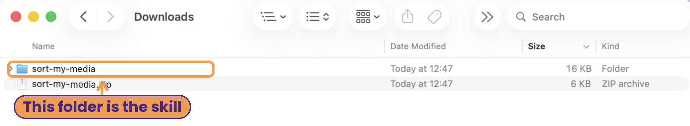
    *Picture: after double-clicking the ZIP, Downloads shows the sort-my-media folder (the skill) next to sort-my-media.zip. You need the folder, not the ZIP.*

2. **Open the hidden skills folder.**
    - **Mac:** click on a Finder window so Finder is the active app (its name shows top left, next to the Apple logo). In the menu bar, click **Go > Go to Folder…** (shortcut **Cmd + Shift + G**, which only works while Finder is active). Type `~/.claude/skills` and press **Enter**.

        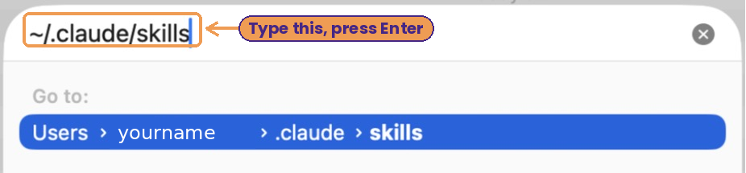
        *Picture: the Go to Folder box with ~/.claude/skills typed in. Press Enter to open the folder. "yourname" will show your own Mac user name.*

    - **Windows:** open File Explorer, click the address bar, type `%USERPROFILE%\.claude\skills` and press **Enter**.

    > **Good to know:** if you get an error that the folder can't be found, create it. Mac: in Finder, open your home folder (**Go > Home**), press **Cmd + Shift + .** (full stop) to show hidden folders, open or create a folder named **.claude**, and inside it create a folder named **skills**. Windows: create **.claude** and then **skills** inside your user folder. More: [Claude Code skills](https://code.claude.com/docs/en/skills).

3. **Drag the sort-my-media folder into the skills folder.**

    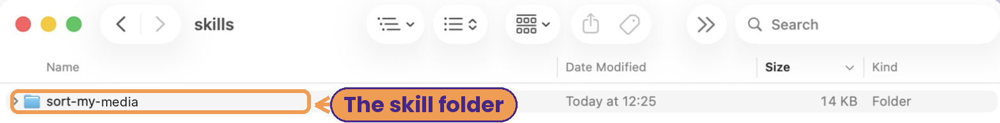
    *Picture: the skills folder after dragging the skill in. It contains the sort-my-media folder.*

### Step 4: open the terminal in your Sort me folder and start Claude Code (2 minutes)

1. **Open the terminal inside your Sort me folder** (see how below for your computer).
2. **Type `claude` and press Enter.** The first time, it opens your browser so you can log in to your Claude account.

    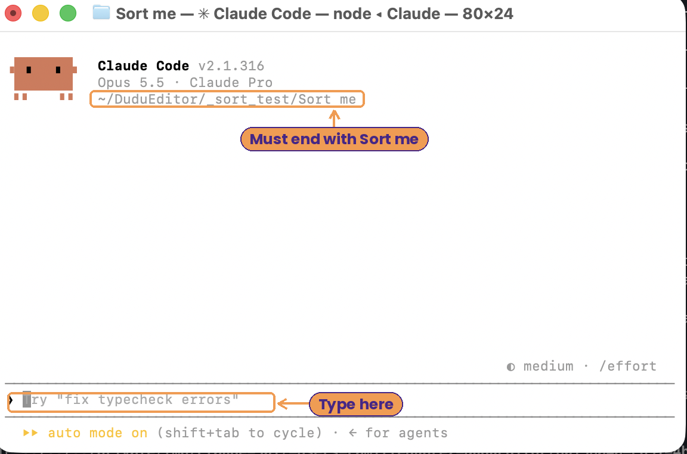
    *Picture: Claude Code is ready. Under the version number you see the folder it works in, which must end with Sort me. You type your messages after the ❯ sign at the bottom.*

> **Good to know:** Claude Code only sees the folder the terminal was opened in. That is why you open it inside Sort me.

#### How to open the terminal inside Sort me

- **Mac:** in Finder, right-click the Sort me folder, choose **Services**, then **New Terminal at Folder**.
- **Windows 11:** open the Sort me folder in File Explorer, right-click an empty space, choose **Open in Terminal**.
- **Windows 10:** open the Sort me folder in File Explorer, hold **Shift**, right-click an empty space, choose **Open PowerShell window here**.
- **Any computer, other way:** open a terminal (Step 1), type `cd` followed by a space, drag the Sort me folder into the window, and press **Enter**.

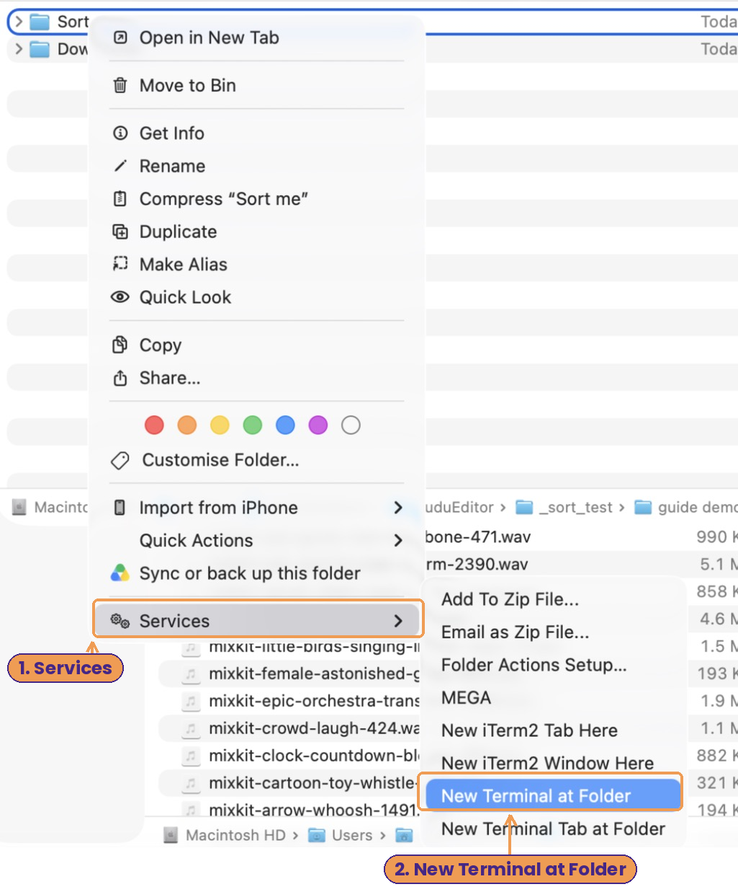
*Picture: on a Mac, right-click the Sort me folder, point to Services at the bottom of the menu, then click New Terminal at Folder. Your list of Services may show other items, depending on the apps you have.*

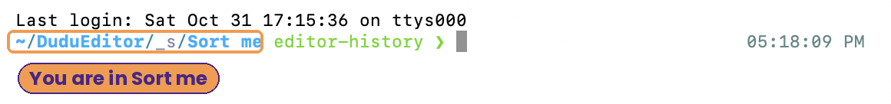
*Picture: a terminal opened inside the Sort me folder. The line ends with the folder name, which shows you are in the right place. Your terminal may look different (colours, text), that is fine.*

### Step 5: answer Claude's questions (1 minute)

1. **Check you are in Sort me.** You opened the terminal *inside* the Sort me folder before typing `claude` (Step 4). If you are not sure, close the window and redo Step 4.
2. **Type `sort my media` and press Enter.** Claude loads the skill and checks your folder and tools.

    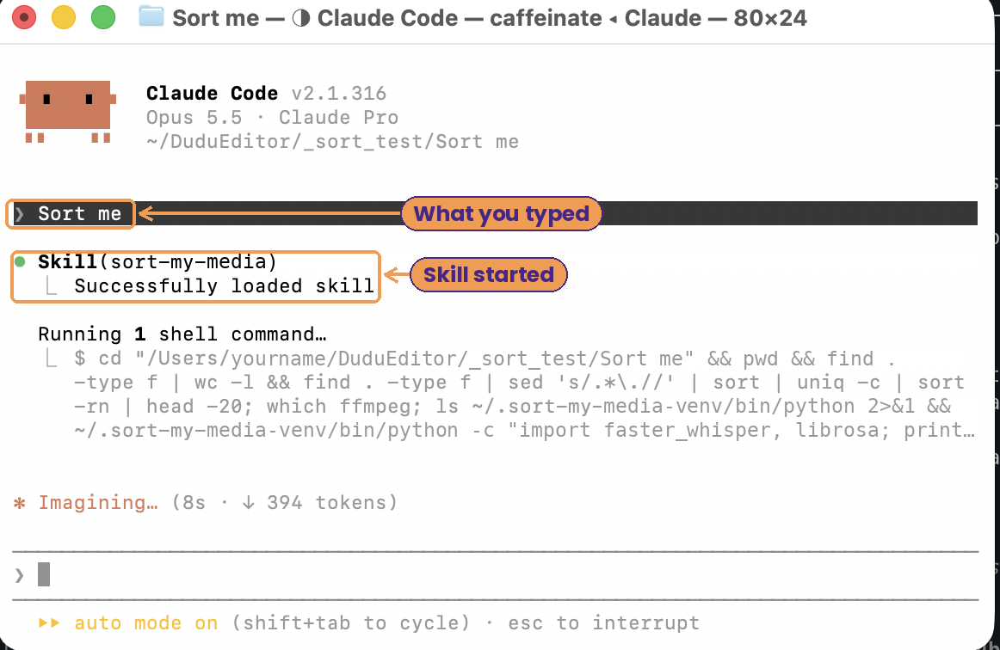
    *Picture: "Skill(sort-my-media) Successfully loaded skill" means the skill started. Here, typing Sort me was enough. Claude then checks how many files are in the folder, and whether ffmpeg and the speech tool are already installed. "yourname" will show your own user name.*

3. **Which folder to sort?** Answer `Sort me`.
4. **What do you use these files for?** Answer for example `content for Instagram`, `family trips` or `work projects`. Claude then shows the sub-folders, adjusted to what you told it. Say `looks good`, or change them in plain words, for example `add a folder called Podcast clips in Videos` or `remove Food and products from Pictures`.
5. **Do you want the sound analysed?** Answer `yes`. Claude then installs a free speech tool in a private folder on your computer (about 30 seconds), and the first time it downloads a small speech model (about 75 MB). It may also need [ffmpeg](https://ffmpeg.org) (to look inside videos and sounds). It always says what and why before installing.

> **Good to know:** you don't need to upload or drag any files into the chat: Claude reads them directly from the folder. Sub-folders are the smaller folders inside each main folder (for example Videos > Talking head). The five main folders (Pictures, Videos, Sounds, Other, Not sure) always stay the same. Sound analysis helps Claude tell a talking head from b-roll, an interview from a talking head, and a voice note from music. If you say no, or if the speech tool does not work, Claude still sorts from the video pictures and whether there is sound.

### Step 6: check the plan, then say go (1 to 5 minutes)

1. **Read the plan.** Claude shows a table: every file and the folder it will go to. Nothing moves yet.
2. **Fix anything that looks wrong**, in plain words, for example `IMG_4822 is a screen recording, not b-roll`
3. **Type `go`.** Claude moves the files and tells you how many went in each folder, and which ones went to "Not sure".
4. **Look at your Sort me folder.** You will find your new folders, a file called **where files went.txt** that lists where every file was moved, and a folder called **_sorter_work** that Claude uses to remember what it did (leave it there if you might want to undo).

    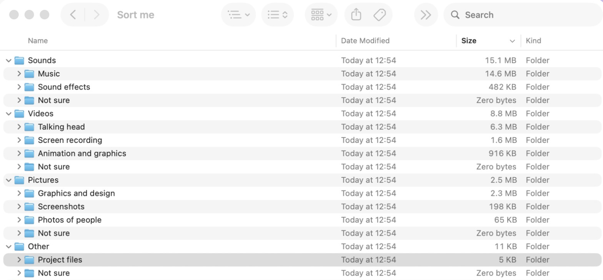
    *Picture: the same Sort me folder after sorting. Files sit in main folders (Sounds, Videos, Pictures, Other) and sub-folders like Talking head or Screenshots. Only the sub-folders that were needed are created.*

> **Good to know:** to undo everything, type `undo the sort`. Every file goes back where it was; the new folders stay behind empty and you can delete them yourself. **Next time**, you only open the terminal in your folder, type `claude`, then `sort my media`, check the plan and type `go`. Sorting a lot of files? See [Sorting a big folder](#sorting-a-big-folder). Something not working? See [If something goes wrong](#if-something-goes-wrong).

## Route A2: Claude Code in the desktop app

Same Claude Code as Route A1, without the terminal, all with buttons. Total the first time: about **15 minutes**. Next times: about **2 minutes of your time**. You need a paid Claude plan (Pro or higher), see [Claude plans](https://claude.com/pricing).

| Step | What you do | Time |
|---|---|---|
| 1 | Install the Claude desktop app | 5 min |
| 2 | Add the skill | 3 min |
| 3 | Open the Code area and choose This computer | 1 min |
| 4 | Start the skill and tell it which folder | 2 min |
| 5 | Answer the use and sound questions | 1 min |
| 6 | Check the plan and say go | 1 to 5 min |

### Step 1: install the Claude desktop app (5 minutes, once)

1. **Download and install the app** from [claude.com/download](https://claude.com/download).
2. **Open it and sign in.**

> **Good to know:** Claude Code is already inside the app, nothing else to install. Official page: [Claude Code desktop](https://code.claude.com/docs/en/desktop).

### Step 2: add the skill (3 minutes, once)

> **What is a skill?** A "skill" is a set of written instructions that teaches Claude a new job. Adding it does not install any program.

1. **Open Customize.** In the Claude app, click **Customize** in the left menu.
2. **Click + Add, then Upload skill.** On the **Skills** tab, click **+ Add** (top right), then **Upload skill**.

    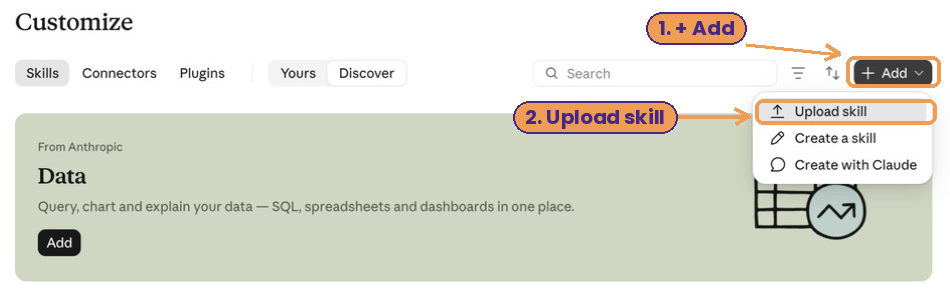
    *Picture: in the Claude app, Customize > Skills. The + Add button (top right) opens a small menu: choose Upload skill.*

3. **Upload the ZIP.** Drag the ZIP file from your Downloads folder into the box (or click **browse** and pick it), then click **Upload**. You upload the ZIP itself, no need to unzip it.

    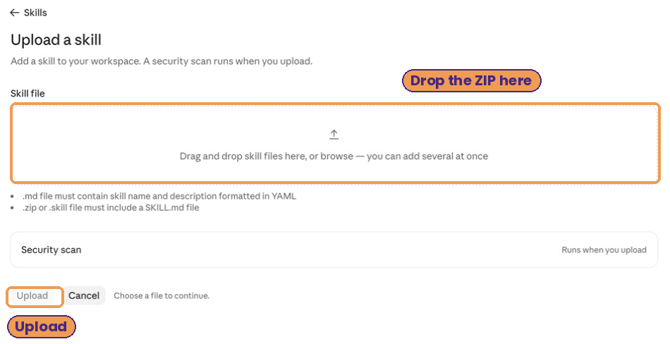
    *Picture: the Upload skill window. Drag the sort-my-media ZIP into the dotted box (or click browse), then click Upload at the bottom left.*

4. **Check it is on.** A short security scan runs. Make sure **sort-my-media** is switched **on** afterwards.

> **Good to know:** skills need code execution. If uploading does not work, open [Settings > Capabilities](https://claude.ai/settings/capabilities) and switch on **Run code in the cloud**.

### Step 3: open the Code area and choose This computer (1 minute)

1. **Click the </> button** at the top of the left menu, next to the speech bubble. This opens the Code area with a **New session**.

    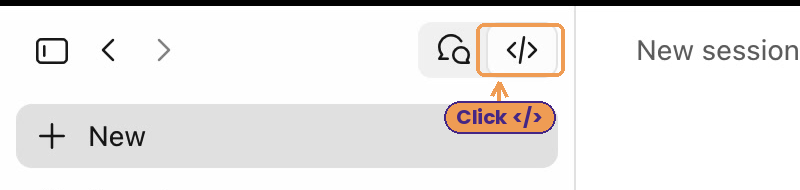
    *Picture: top left of the Claude desktop app. The speech bubble opens the normal chat, the </> button opens the Code area.*

2. **Choose This computer.** In the middle of the screen, click **Choose environment** and pick **This computer** (under Local), so Claude works on the files on your computer.

    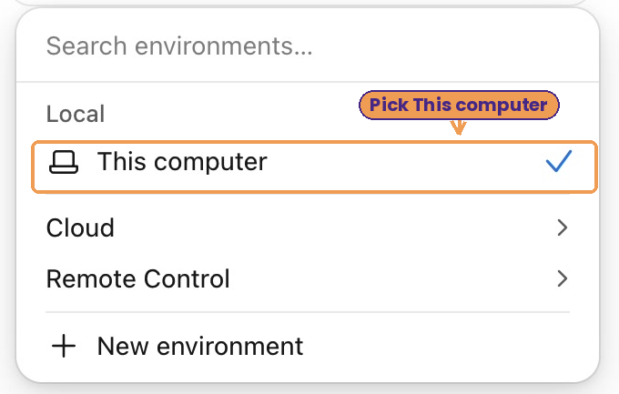
    *Picture: the Choose environment menu. Pick This computer under Local. Cloud and Remote Control are other options you don't need here.*

### Step 4: start the skill and tell it which folder (2 minutes)

1. **Type `/sort` in the message box and pick the skill.** A small list appears: click **sort-my-media** (it can show as anthropic-skills:sort-my-media), then press **Enter**.

    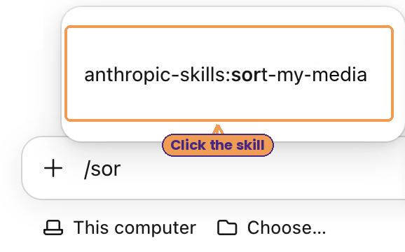
    *Picture: typing /sor in the message box shows the skill. Click it and press Enter. This computer is shown under the box.*

2. **Read Claude's questions.** Claude asks which folder to sort and what the files are for, and shows the default folder list.

    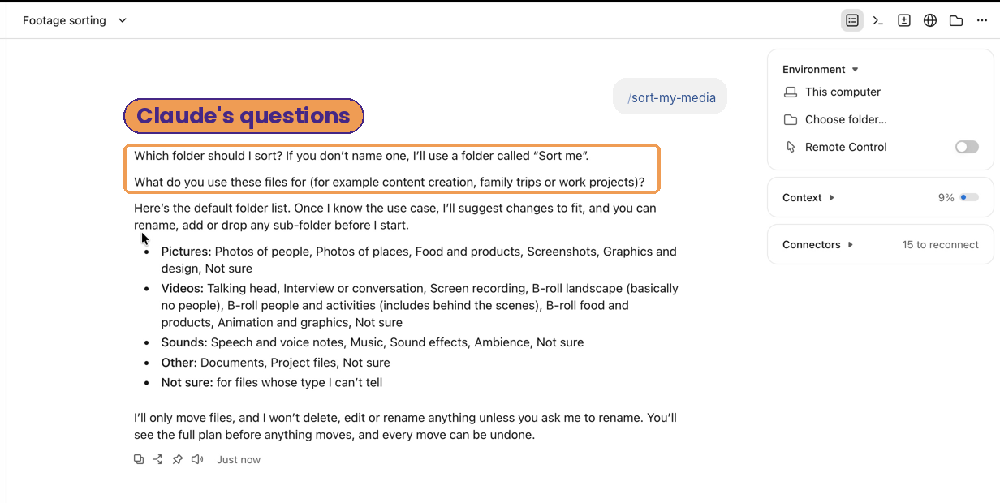
    *Picture: Claude's first answer after /sort-my-media.*

3. **Tell it which folder** by pasting the folder's full address (its "path"):
    - **Mac:** in Finder, right-click the Sort me folder, then hold the **Option** key: "Copy" changes to **Copy "Sort me" as Pathname**. Click it, then paste in the message box (**Cmd + V**).
    - **Windows:** in File Explorer, hold **Shift** and right-click the Sort me folder, then choose **Copy as path**. Paste in the message box (**Ctrl + V**).
    - **Or** simply type the folder name, `Sort me`, and Claude looks for it. If it finds several, it asks you which one.

> **Good to know:** you don't need to upload or drag any files into the chat: Claude reads them directly from the folder.

### Step 5: answer the use and sound questions (1 minute)

1. **Say what the files are for**, in the same message or the next one, for example `content for Instagram`, `family trips` or `work projects`. Claude then shows the sub-folders, adjusted to what you told it. Say `looks good`, or change them in plain words, for example `add a folder called Podcast clips in Videos`.
2. **Say yes to the sound analysis.** Click **Yes, with sound** (or type `yes`). Claude then installs a free speech tool in a private folder on your computer (about 30 seconds), and the first time it downloads a small speech model (about 75 MB). It always says what and why before installing.

    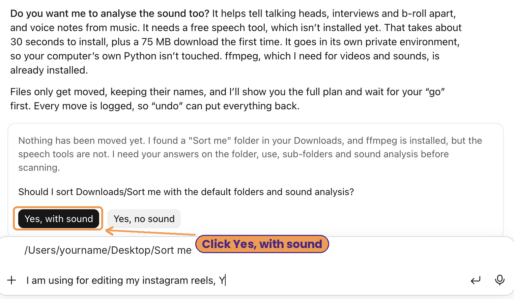
    *Picture: Claude asks "Do you want me to analyse the sound too?" with two buttons. Here the folder path and the answer are typed in the message box. "yourname" will show your own user name and the place of your folder.*

3. **Let Claude work.** Claude shows its to-do list and installs the speech tool in the background.

    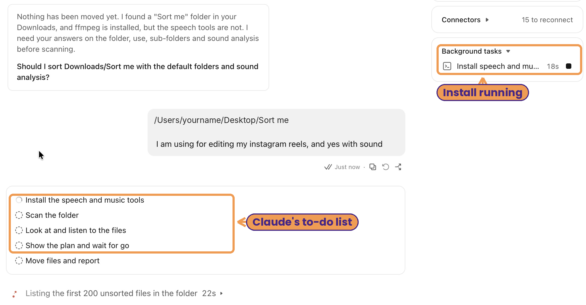
    *Picture: after the answer "yes with sound", Claude shows its to-do list (install the speech and music tools, scan, look and listen, show the plan, move files). The install runs on the right under Background tasks.*

4. **Allow access if asked.** Claude may ask your permission before it reads or moves files. Allow it for the Sort me folder.

> **Good to know:** the five main folders (Pictures, Videos, Sounds, Other, Not sure) always stay the same. Sound analysis helps Claude tell a talking head from b-roll, an interview from a talking head, and a voice note from music. If you say no, or if the speech tool does not work, Claude still sorts from the video pictures and whether there is sound.

### Step 6: check the plan, then say go (1 to 5 minutes)

1. **Read the plan.** Claude shows a table: every file and the folder it will go to. Nothing moves yet.
2. **Fix anything that looks wrong**, in plain words, for example `IMG_4822 is a screen recording, not b-roll`
3. **Type `go`.** Claude moves the files and tells you how many went in each folder, and which ones went to "Not sure".
4. **Look at your Sort me folder.** You will find your new folders, a file called **where files went.txt** that lists where every file was moved, and a folder called **_sorter_work** that Claude uses to remember what it did (leave it there if you might want to undo).

    
    *Picture: the same Sort me folder after sorting. Files sit in main folders (Sounds, Videos, Pictures, Other) and sub-folders like Talking head or Screenshots. Only the sub-folders that were needed are created.*

> **Good to know:** to undo everything, type `undo the sort`. Every file goes back where it was; the new folders stay behind empty and you can delete them yourself. **Next time**, you only open a new Code session on This computer, type `/sort`, give the folder, check the plan and type `go`. Sorting a lot of files? See [Sorting a big folder](#sorting-a-big-folder). Something not working? See [If something goes wrong](#if-something-goes-wrong).

## Route B: the Claude app chat

This means the normal Claude chat in the **Claude desktop app** (not the Code area behind the </> button, and not the website). Total the first time: about **20 minutes**. Next times: about **2 minutes of your time**.

| Step | What you do | Time |
|---|---|---|
| 1 | Install the Claude desktop app | 5 min |
| 2 | Add the skill | 3 min |
| 3 | Turn on code execution and speech detection | 5 min |
| 4 | Start the skill and answer the three questions | 2 min |
| 5 | Answer any follow-up questions | 1 min |
| 6 | Check the plan and say go | 1 to 5 min |

> **Good to know:** the website cannot open folders on your computer, so use the desktop app.

### Step 1: install the Claude desktop app (5 minutes, once)

1. **Download and install the app** from [claude.com/download](https://claude.com/download).
2. **Open it and sign in.**

### Step 2: add the skill (3 minutes, once)

> **What is a skill?** A "skill" is a set of written instructions that teaches Claude a new job. Adding it does not install any program.

1. **Open Customize.** In the Claude app, click **Customize** in the left menu.
2. **Click + Add, then Upload skill.** On the **Skills** tab, click **+ Add** (top right), then **Upload skill**.

    
    *Picture: in the Claude app, Customize > Skills. The + Add button (top right) opens a small menu: choose Upload skill.*

3. **Upload the ZIP.** Drag the ZIP file from your Downloads folder into the box (or click **browse** and pick it), then click **Upload**. You upload the ZIP itself, no need to unzip it.

    
    *Picture: the Upload skill window. Drag the sort-my-media ZIP into the dotted box (or click browse), then click Upload at the bottom left.*

4. **Check it is on.** A short security scan runs. Make sure **sort-my-media** is switched **on** afterwards.

### Step 3: turn on code execution and speech detection (5 minutes, once)

1. **Open [Settings > Capabilities](https://claude.ai/settings/capabilities)** and scroll to **Code execution and file creation**.
2. **Switch on Run code in the cloud** (needed for skills).
3. **Switch on Allow network egress.** Leave **Domain allowlist** on **Package managers only**.
4. **Add the speech tool's websites.** In **Additional allowed domains**, type each of these and click **Add** after each one: `pypi.org`, `files.pythonhosted.org`, `huggingface.co`, `*.hf.co`

    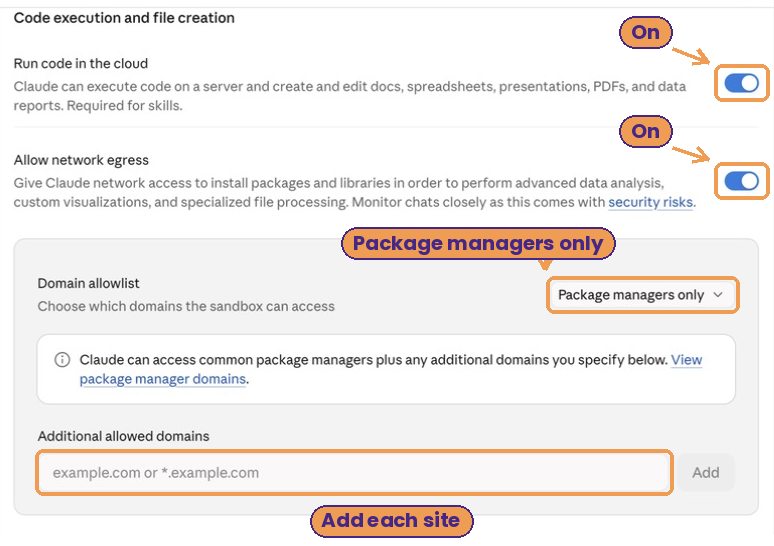
    *Picture: Settings > Capabilities > Code execution and file creation. Both switches on, Domain allowlist on Package managers only, then each site added in Additional allowed domains.*

> **Good to know:** skills need code execution, and speech detection needs a free speech tool that Claude downloads from these sites. Speech detection helps Claude tell a talking head from b-roll, and an interview from a talking head. If it does not work, Claude still sorts from the video pictures and whether there is sound. Anthropic's help page: [Use skills in Claude](https://support.claude.com/en/articles/12512180).

### Step 4: start the skill and answer the three questions (2 minutes)

1. **Start a new chat, type `/sort`, pick sort-my-media and press Enter.**

    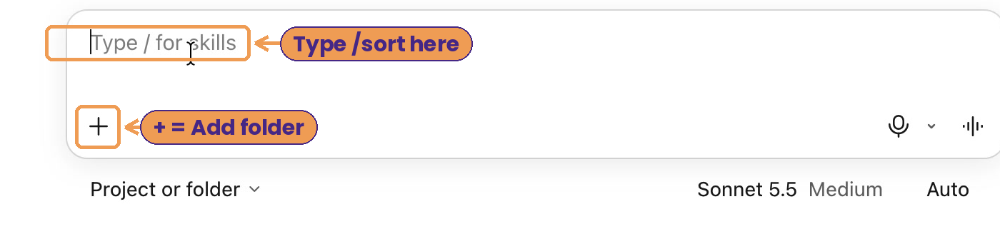
    *Picture: the message box of a new chat ("Type / for skills"). Type /sort here. The + button at the bottom left is another way to add your folder.*

2. **Read the three questions.** Claude asks which folder to sort, what you use the files for, and whether you want the sound analysed. It also shows the folders it will create.

    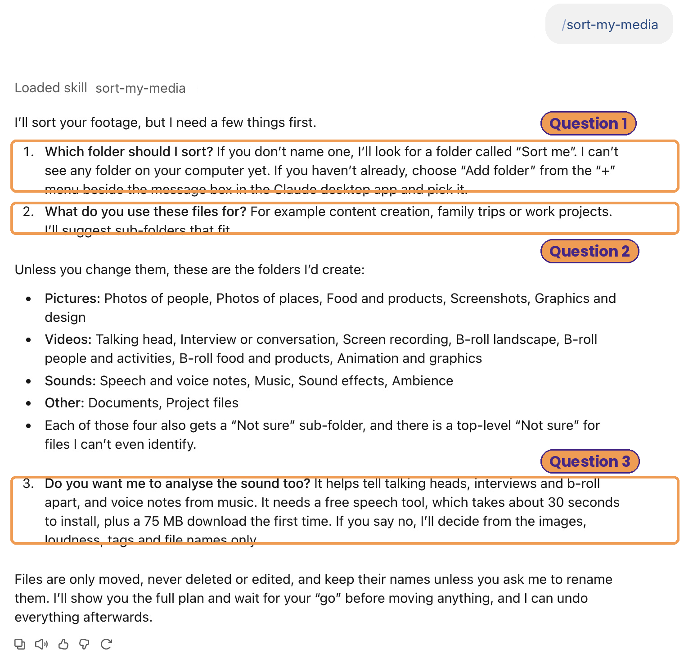
    *Picture: Claude's first answer after /sort-my-media, with the three questions and, in between, the folders it will create.*

3. **Answer all three in one message**, for example:

    ```
    1. this folder: (paste the path here)
    2. content for Instagram
    3. yes
    ```

    To get the folder's full address (its "path"):

    - **Mac:** in Finder, right-click the Sort me folder, then hold the **Option** key: "Copy" changes to **Copy "Sort me" as Pathname**. Click it, then paste in the message box (**Cmd + V**).
    - **Windows:** in File Explorer, hold **Shift** and right-click the Sort me folder, then choose **Copy as path**. Paste in the message box (**Ctrl + V**).

    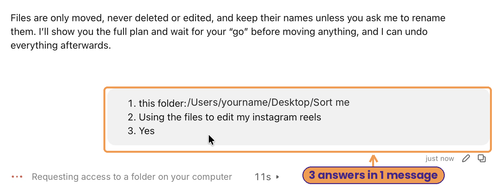
    *Picture: one message answers the three questions. "yourname" will show your own user name and the place of your folder. Claude then asks to access that folder on your computer.*

4. **Click Allow if your computer asks** for permission to access the folder. Only allow this folder, nothing else. Claude then confirms how many files it can see.

    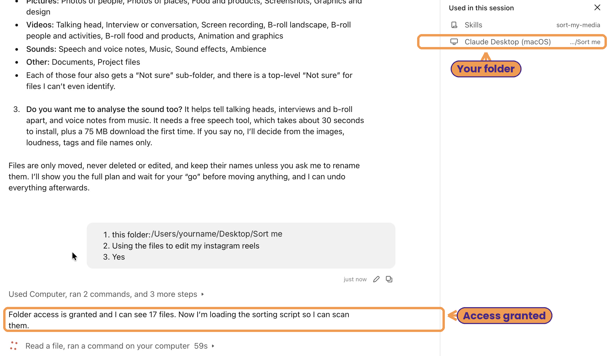
    *Picture: "Folder access is granted and I can see 17 files." On the right, Used in this session shows the skill and Claude Desktop (macOS) with your Sort me folder.*

#### Other way: Add folder

1. **Click the + at the bottom left of the message box, choose Add folder**, pick your **Sort me** folder and click **Open**. The folder shows as a small card in the message box.

    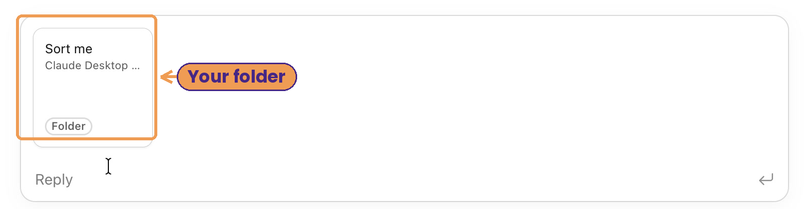
    *Picture: after Add folder, the Sort me folder shows as a card in the message box.*

2. **Click Allow** when your computer asks **Allow Claude to access this folder?**

    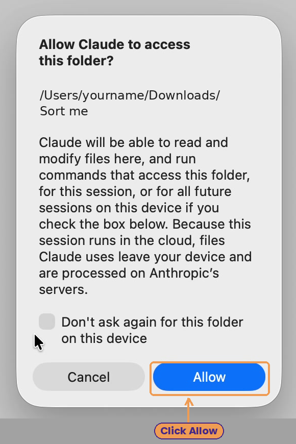
    *Picture: the permission window for Add folder.*

> **Good to know:** with Add folder, as the window says, the files Claude uses are processed on Anthropic's servers. If you prefer your files to stay on your computer, paste the path instead, or use Route A1 or A2. Either way, you don't need to upload or drag any files into the chat.

### Step 5: answer any follow-up questions (1 minute)

1. **Click an option on Claude's question cards**, or type your own answer in **Something else**. Claude may ask a few more short questions, for example which sub-folders you want.

    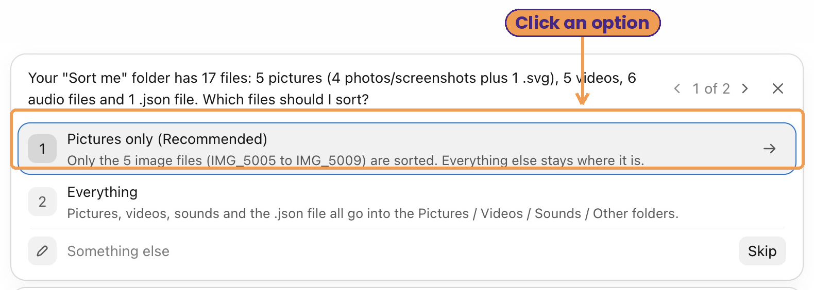
    *Picture: one of Claude's question cards. "1 of 2" means there is a second question after this one.*

2. **Let Claude install the speech tool** if you said yes to sound analysis. It installs it in a private folder (about 30 seconds), and the first time it downloads a small speech model (about 75 MB). It says what it installs and why.

> **Good to know:** if you say no to sound, or if the speech tool does not work, Claude still sorts from the video pictures and whether there is sound.

### Step 6: check the plan, then say go (1 to 5 minutes)

1. **Read the plan.** Claude shows a table: every file and the folder it will go to. Nothing moves yet.

    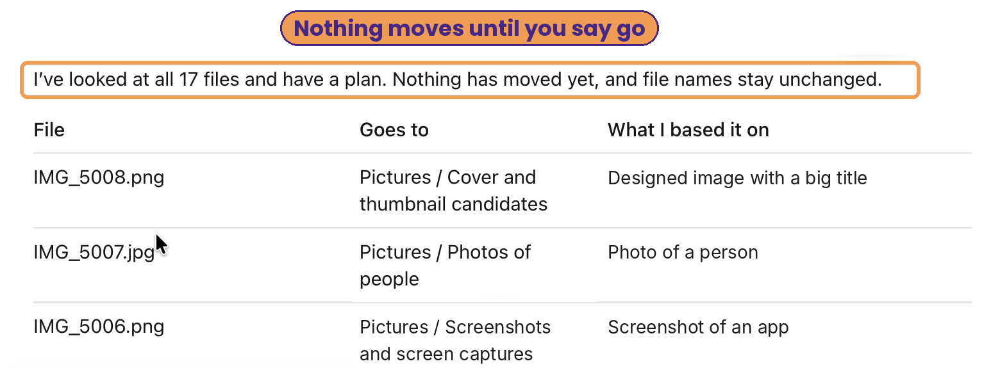
    *Picture: the start of a plan. For each file: the folder it goes to, and what Claude based it on.*

2. **Fix anything that looks wrong**, in plain words, for example `IMG_4822 is a screen recording, not b-roll`
3. **Type `go`.** Claude moves the files and tells you how many went in each folder, and which ones went to "Not sure".
4. **Look at your Sort me folder.** You will find your new folders, a file called **where files went.txt** that lists where every file was moved, and a folder called **_sorter_work** that Claude uses to remember what it did (leave it there if you might want to undo).

    
    *Picture: the same Sort me folder after sorting. Files sit in main folders (Sounds, Videos, Pictures, Other) and sub-folders like Talking head or Screenshots. Only the sub-folders that were needed are created.*

> **Good to know:** to undo everything, type `undo the sort`. Every file goes back where it was; the new folders stay behind empty and you can delete them yourself. **Next time**, you only start a new chat, type `/sort`, give the folder, check the plan and type `go`. Sorting a lot of files? See [Sorting a big folder](#sorting-a-big-folder). Something not working? See [If something goes wrong](#if-something-goes-wrong).

# For every route

## How Claude decides (in plain words)

- **Pictures:** it looks at them.
- **Videos:** it takes 4 still pictures from each clip and looks at them, checks whether there is sound, and listens for speech (if you said yes to sound).
- **Sounds:** it does not listen to music. It uses the length (very short = sound effect, long = music), the information stored in the file (title, artist, genre), and speech detection for voices.
- **Not sure?** The file goes to a "Not sure" folder instead of a wrong one.

## Sorting a big folder

Yes, you can sort more than 200 files. There is no maximum. Claude simply works in batches of 200:

1. **Put all your files in Sort me**, even 1,000 or more.
2. **Start the sort as usual.** Claude shows the plan for the first 200 files.
3. **Check it and type `go`.** Claude moves them, then shows the plan for the next 200.
4. **Repeat until it says everything is sorted.** For 1,000 files, that is 5 plans and 5 times `go`.

> **Good to know:** it takes longer, because Claude looks at a few pictures from every video, so you can leave it running and come back to check the next plan. Big folders also use more of your Claude usage. If Claude stops (for example you reach your usage limit), start the sort again later: files already sorted are skipped, so it carries on where it stopped. Nothing is lost.

## If something goes wrong

| What you see | What to do |
|---|---|
| Claude does not seem to know the skill | **Route A1:** check that the sort-my-media folder is inside .claude/skills, then close the terminal window, open it again in Sort me and type `claude`. **Route A2:** check in Customize > Skills that sort-my-media is switched on, then start a new session in the Code area. **Route B:** check in Customize > Skills that sort-my-media is switched on and that Run code in the cloud is on, then start a new conversation. Help: [Use skills in Claude](https://support.claude.com/en/articles/12512180). |
| Claude says it cannot see your files | **Route A1:** open the terminal inside the Sort me folder before typing `claude`. **Route A2:** make sure This computer is selected, and paste the full path of the Sort me folder (Step 4). **Route B:** paste the full path of the Sort me folder in your answer (Step 4), or add it with + > Add folder, and click Allow when asked. |
| A file is in the wrong folder | Move it yourself, or tell Claude: `move IMG_123 to Videos/Talking head` |
| Lots of files in "Not sure" | Tell Claude what they are in plain words (`the long ones are podcast recordings`), and ask it to sort the Not sure folders again. |
| You want everything back | Type `undo the sort` |
| Claude Code will not install or start (Route A1) | Follow [Troubleshoot installation](https://code.claude.com/docs/en/troubleshoot-install). |

## The folders you get (full details)

Five main folders: **Pictures, Videos, Sounds, Other, Not sure.** Inside each, Claude picks a sub-folder using the logic below. You can rename, add or remove sub-folders before Claude starts. "Confidence" shows how reliably Claude sorts each kind of file.

### Pictures

| Sub-folder | What goes in | How Claude decides | Confidence |
|---|---|---|---|
| Photos of people | Portraits, selfies, groups | Looks at the image | High |
| Photos of places | Landscapes, cities, buildings, travel | Looks at the image | High |
| Food and products | Meals, items, product shots | Looks at the image | High |
| Screenshots | Phone or computer screen captures | Text, app windows, screen size shape | High |
| Graphics and design | Logos, posters, illustrations, made on a computer | Looks at the image, no camera look | Medium |
| Not sure | Pictures that fit none of the above | | |

### Videos

| Sub-folder | What goes in | How Claude decides | Confidence |
|---|---|---|---|
| Talking head | One person speaking to the camera | One face close up, and the clip has sound (speech, if sound analysis is on) | High |
| Interview or conversation | Two or more people talking | Several people, and the clip has speech (best with sound analysis on) | Medium |
| Screen recording | Computer or phone screen being used | Frames show an app or desktop | High |
| B-roll: landscape | Scenery, streets, nature, with basically no people in it | A place without people | High |
| B-roll: people and activities | People doing things, no speech to camera. Also behind-the-scenes footage | People, no speech | Medium |
| B-roll: food and products | Close shots of food or items | Food or objects | High |
| Animation and graphics | Made on a computer, not filmed | Frames look drawn or rendered | Medium |
| Not sure | Videos that fit none of the above | | |

> **Good to know:** time-lapse, drone and slow motion are not separate folders, because they describe how a clip was filmed, not what is in it.

### Sounds

| Sub-folder | What goes in | How Claude decides | Confidence |
|---|---|---|---|
| Speech and voice notes | Talking, recordings of a voice | Speech check or transcript | High with a transcript |
| Music | Songs, background tracks | Tags (title, artist, genre), file name, length (usually over 30 seconds) | Medium |
| Sound effects | Whoosh, click, pop, short sounds | Very short length (under about 5 seconds), file name, tags | Medium |
| Ambience | Long background sounds: rain, cafe, city | Long length, no beat, no speech, file name | Low to medium |
| Not sure | Sounds that fit none of the above | | |

### Other and Not sure

| Folder | What goes in |
|---|---|
| Other > Documents | PDFs, text, spreadsheets, slides |
| Other > Project files | Editor or design files, data files |
| Other > Not sure | Anything else |
| Not sure (main folder) | Files Claude cannot even tell the type of (for example an unknown file ending) |

## Copyright

© 2026 Dudu.exe ([@dudu.experiments](https://www.instagram.com/dudu.experiments/)). This guide and the sort-my-media skill were made by Dudu.exe and are **free**.

You may use them and share them for free, as long as you credit Dudu.exe. **Do not sell them**, on their own or inside a paid product, course or bundle, and do not sell a changed version of them.

Licence: [Creative Commons Attribution-NonCommercial 4.0 (CC BY-NC 4.0)](https://creativecommons.org/licenses/by-nc/4.0/).
