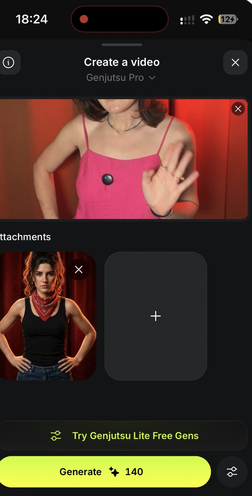
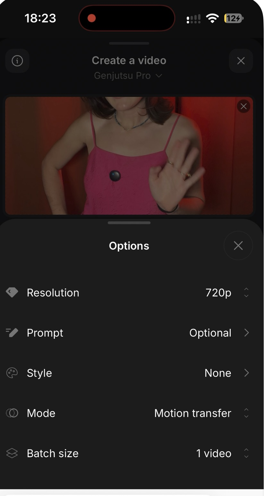
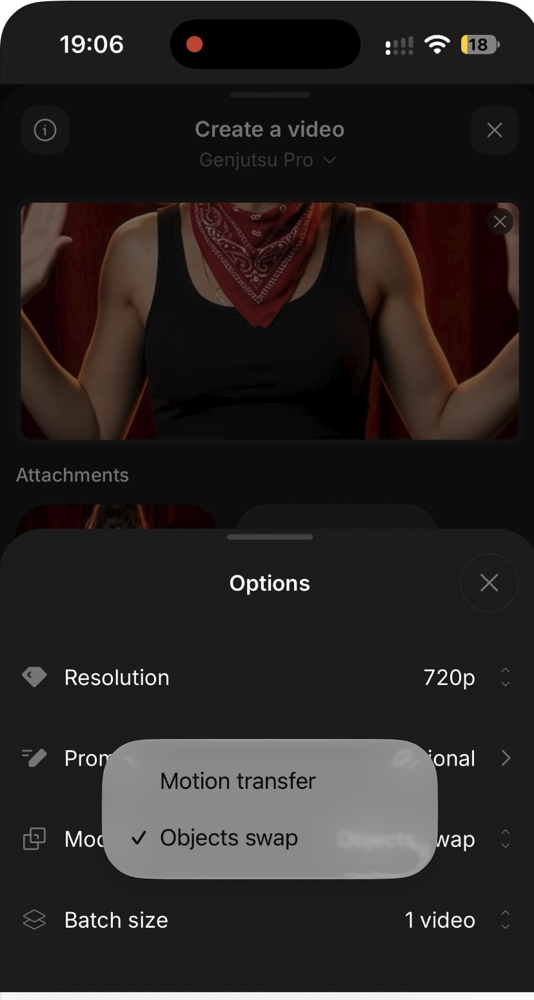
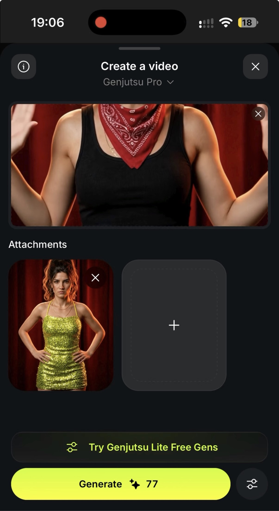

# Turn yourself into a game character with Higgsfield Genjutsu

Film yourself once, then turn yourself into a video game character (for example a GTA look), change your outfit and change the place, all inside the same video.

## What you get
- A short video where you become a game character and keep your own moves and timing.
- Outfit and background changes inside that video, without filming again.
- A clear split: which parts need Higgsfield and which parts can use any picture tool.

## What you need
- A Higgsfield account with credits. In tests one video step cost between 77 and 140 credits.
- A phone or camera on a stand, so the camera does not move.
- Any picture generator for the base pictures (for example Nano Banana or ChatGPT).
- Seedance 2.5 if something has to appear from nothing in your video, such as a car.

> [!TIP]
> **The idea in one line**
> Make the pictures first (character, outfits, backgrounds), then use Genjutsu to put those pictures into your video.

## Step 1: Plan the story, then film the main video
- Write the story first: the theme, the order of the scenes and the lines you will say.
- Film the main video once, in one take, with a fixed camera.
- Keep the same framing in every shot. Why: every later step starts from this one video, and the same framing makes the swaps look clean.

## Step 2: Make the base pictures
Make three kinds of pictures before you open Higgsfield:
- **The character:** you, turned into the character you want.
- **The outfits** you want to switch to.
- **The backgrounds** you want to switch to.

> [!TIP]
> **Use any picture tool**
> This step does not need Higgsfield. Nano Banana, ChatGPT or any other picture generator works. Higgsfield can make pictures too, so use it if you like. Only the video steps below need Higgsfield.

Keep the same style in all the pictures, so the character, the outfit and the background feel like one world. Why: mixed styles make the final video look stitched together.

## Step 3: Become the character (Motion transfer)
On Higgsfield, open Genjutsu and choose the mode **Motion transfer**.
1. Put your filmed video in the top slot. It gives the movement.
2. Add your character picture under Attachments. It is the person who will move.
3. Check the price on the Generate button, then press Generate.

The character now does what you did in the video: same moves, same timing.

*Motion transfer: your filmed video on top, the character picture in Attachments. Here the price is 140 credits.*

To pick the mode, open Options, then Mode.

*Options with Mode set to Motion transfer. Resolution 720p, Prompt optional, Style none.*

## Step 4: Change the outfit and the background (Objects swap)
To change something inside a video, switch the mode to **Objects swap**. The same mode does both:
- **Outfit:** put the character video in the top slot and the outfit picture in Attachments.
- **Background:** same thing, with the background picture in Attachments.

*The mode menu: Motion transfer or Objects swap.*

*Objects swap for an outfit: the character video on top, the dress picture in Attachments. Here the price is 77 credits.*

## Step 5: Add things that appear from nothing (Seedance 2.5)
Do not use Genjutsu for something new, such as a car that drives into the scene. Make that scene with **Seedance 2.5**. Why: Genjutsu changes what is already in a video, it does not create new objects.

## Checklist
- [ ] Story planned, main video filmed with a fixed camera
- [ ] Character, outfits and backgrounds made (any picture tool)
- [ ] Genjutsu, Motion transfer: you become the character
- [ ] Genjutsu, Objects swap: outfit
- [ ] Genjutsu, Objects swap: background
- [ ] Seedance 2.5: anything that appears from nothing

## Good to know
- **Credits:** the price depends on the length of your video and the settings. Always read it on the Generate button first.
- **Test cheaply:** try "Genjutsu Lite Free Gens" first, and test each step on a short clip.
- **One step at a time:** check each result before you start the next step, because each step builds on the one before.
- **The result looks stitched together:** make the pictures again in one style, and keep the same framing as your filmed video.

## Credit and licence
Made by dudu.exe ([@dudu.experiments](https://www.instagram.com/dudu.experiments/)).

© 2026 dudu.exe. You are welcome to use this guide for yourself, learn from it and adapt it for personal, non-commercial use. Please do not sell it, resell it or use it to make money, and please credit dudu.exe if you share or build on it.

Higgsfield, Genjutsu, Seedance, Nano Banana, ChatGPT and GTA belong to their owners. This guide is not linked to or paid for by any of them.
